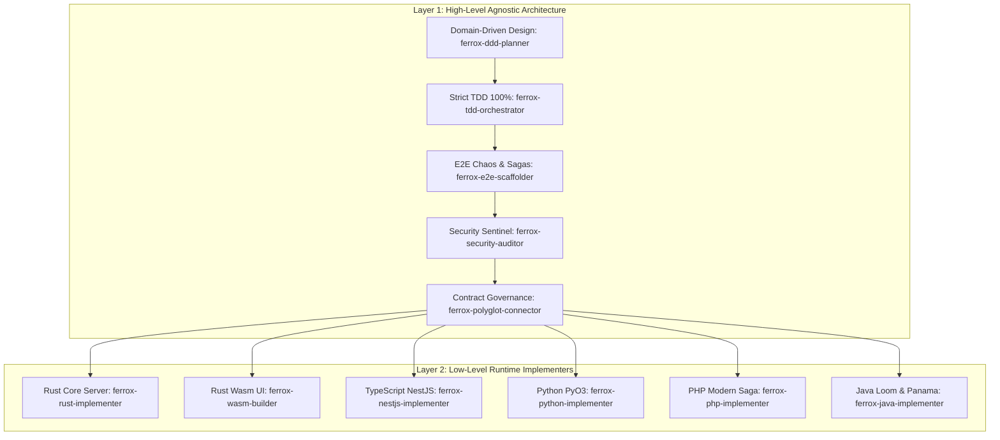

# Ferrox Agent Operating Guide (Dual-Layer Architecture)

Welcome, Agent. You are operating within the Ferrox polyglot ecosystem or utilizing the **Ferrox Agent Toolkit**.
You MUST adhere strictly to the two-tier engineering structure:

---

## 1. Layer 1: High-Level Agnostic Workflow

Every feature, ticket, or refactor must follow this sequential progression regardless of language:

1. **DDD Planning (`rules/ferrox-ddd-architecture.md`)**:
   - Invoke `skills/ferrox-ddd-planner` to define Bounded Contexts, Ubiquitous Language terms, Aggregate Roots, and immutable Value Objects.
   - Output `DDD_PLAN.md` and obtain alignment before writing implementation code.
2. **Strict TDD & 100% Coverage (`rules/ferrox-tdd-100-percent.md`)**:
   - Write failing unit tests first (RED). Turn them green with minimal code (GREEN). Refactor cleanly (REFACTOR).
   - Domain unit tests must execute completely in-memory in under 5 milliseconds.
   - Run `python scripts/check_coverage.py` to prove **100% Line and Branch Coverage**.
   - Enforce mutation testing (e.g. `cargo mutants`, `stryker`, `infection`, `pitest`) aiming for $\ge 85\%$ MSI.
3. **E2E Chaos Resilience (`rules/ferrox-e2e-chaos-resilience.md`)**:
   - Verify happy path golden customer journeys.
   - Test mandatory edge cases: concurrency double-spend (20 parallel requests on 3 items), Saga compensations/rollbacks, circuit breaker fail-fast, singleflight deduplication, and clock skew boundaries (10s tolerance).
4. **Ferrox Security Sentinel (`rules/ferrox-sentinel-security.md`)**:
   - Run `python scripts/run_wstg_security_scanner.py`.
   - Verify Shannon entropy filtering ($H \le 4.8$ for natural text; $H > 4.8$ blocked as potential shellcode).
   - Verify PASETO v4 token security (Additional Authenticated Data footer binding, zero-entropy symmetric key rejection).
   - Verify constant-time comparison for secrets and memory isolation (`SealedToken`).
5. **Contract Governance (`rules/ferrox-contract-governance.md`)**:
   - Maintain backwards-compatible Protobuf v3 schemas (`buf breaking`).
   - Validate CloudEvents v1.0 standard envelopes across message streams.

---

## 2. Layer 2: Specialized Runtime Implementers

Select the specialized agent or skill appropriate for the target repository:

| Runtime | Specialized Agent | Executive Skill | Governing Rule | Key Idioms |
| :--- | :--- | :--- | :--- | :--- |
| **Rust Core** | `agents/ferrox-rust-specialist.md` | `skills/ferrox-rust-implementer` | `rules/ferrox-rust-guidelines.md` | 1M RPS, zero-alloc, `bytes::Bytes`, Tokio async, `thiserror`, lock-free. |
| **Rust Wasm** | `agents/ferrox-wasm-specialist.md` | `skills/ferrox-wasm-builder` | `rules/ferrox-wasm-guidelines.md` | Zero Node.js/VDOM, `Signal<T>` reactivity, 60 FPS, vector SVG, `wasm-opt`. |
| **TypeScript / NestJS** | `agents/ferrox-polyglot-implementer.md` | `skills/ferrox-nestjs-implementer` | `rules/ferrox-typescript-nestjs-guidelines.md` | YALC modular onion, CQRS Command/Query buses, Node-API (`napi-rs`), RFC 7807. |
| **Python** | `agents/ferrox-polyglot-implementer.md` | `skills/ferrox-python-implementer` | `rules/ferrox-python-pyo3-guidelines.md` | Python 3.12+, PyO3 with GIL release, frozen Pydantic v2, `asyncio`, Hypothesis. |
| **PHP** | `agents/ferrox-polyglot-implementer.md` | `skills/ferrox-php-implementer` | `rules/ferrox-php-guidelines.md` | PHP 8.4 `final readonly`, Saga forward/compensating steps, PSR-7/14/15, Infection. |
| **Java 21+** | `agents/ferrox-polyglot-implementer.md` | `skills/ferrox-java-implementer` | `rules/ferrox-java-loom-panama-guidelines.md` | Virtual Threads (Loom), Project Panama off-heap FFI, Records & Sealed ADTs, ArchUnit. |

---

## 3. Specialized Agent Roster

- **`ferrox-architect-ddd`**: Lead Domain Modeler and Bounded Context Architect.
- **`ferrox-tdd-engineer`**: Red-Green-Refactor master and 100% Coverage Guardian.
- **`ferrox-security-sentinel`**: Penetration tester and OWASP WSTG Security Auditor.
- **`ferrox-qa-chaos-engineer`**: Distributed resilience, race conditions, and Saga compensations tester.
- **`ferrox-rust-specialist`**: High-performance Rust systems engineer (1M RPS, zero-alloc).
- **`ferrox-wasm-specialist`**: Reactive WebAssembly pure UI architect (Signal, 60 FPS, SVG).
- **`ferrox-polyglot-implementer`**: Cross-language FFI (Panama, PyO3, Node-API) and gRPC/CloudEvents engineer.
