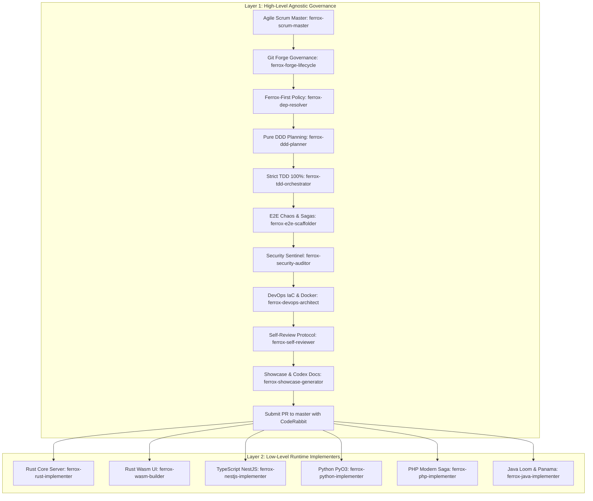

# Ferrox Agent Operating Guide (Dual-Layer Agile Scrum Architecture)

Welcome, Agent. You are operating within the Ferrox polyglot ecosystem or utilizing the **Ferrox Agent Toolkit**.
You MUST adhere strictly to the two-tier engineering structure governed by the **Ferrox Master Orchestrator**:

---

## 1. Layer 1: High-Level Agnostic Lifecycle

1. **Agile Scrum Decomposition (`rules/ferrox-agile-scrum-lifecycle.md`)**:
   - Decompose brief into Epics, Stories, and Atomic Tasks with acceptance criteria.
   - Enforce Definition of Ready (DoR) gate before coding begins.
2. **Git Forge Governance (`rules/ferrox-git-lifecycle-governance.md`)**:
   - Create Milestone and tracking Issue via `gh issue create` / `glab issue create`.
   - Checkout branch: `feature/issue-<id>-<slug>`.
3. **Ferrox-First Dependency Policy (`rules/ferrox-first-dependency-policy.md`)**:
   - Prioritize native Ferrox packages (`ferrox`, `ferrox-front`, `ferrox-codex`, `ferrox-py-auth`, `nestjs-yalc`).
   - Require formal justification for any external dependency.
4. **DDD Domain Modeling (`rules/ferrox-ddd-architecture.md`)**:
   - Isolate pure domain models from frameworks. Define invariants, Value Objects, and CQRS contracts.
5. **Strict TDD & 100% Coverage (`rules/ferrox-tdd-100-percent.md`)**:
   - Write failing tests first. Pure domain tests execute in $< 5\text{ms}$.
   - Verify 100% line & branch coverage via `python scripts/check_coverage.py`.
   - Ensure mutation testing passes ($\ge 85\%$ MSI).
6. **E2E Chaos & Resilience (`rules/ferrox-e2e-chaos-resilience.md`)**:
   - Verify golden customer paths and chaos tests (double-spend race conditions, distributed Saga rollbacks).
7. **OWASP WSTG Sentinel Security (`rules/ferrox-sentinel-security.md`)**:
   - Run `python scripts/run_wstg_security_scanner.py` (Shannon entropy filter $H \le 4.8$, PASETO v4 AAD footer binding).
8. **DevOps & IaC Scaffolding (`rules/ferrox-devops-infrastructure-iac.md`)**:
   - Scaffold distroless Dockerfile (<25MB), Redpanda/Kafka & Redis docker-compose, and Terraform VPS/Cloud manifests.
9. **Disciplined Self-Review (`rules/ferrox-self-review-standards.md`)**:
   - Run `python skills/ferrox-self-reviewer/scripts/scan_diff_debris.py`.
   - Eliminate all debug code (`dbg!`, `console.log`, `print`, `var_dump`).
10. **Interactive Documentation on Ferrox-Codex**:
    - Compile documentation and live Wasm sandboxes into `ferrox-codex`.
11. **Pull Request Submission Targeting `master`**:
    - Push branch and open PR via `gh pr create --base master --body "Resolves #<id>..."` with full quality gate proofs.

---

## 2. Specialized Agent Roster (10 Agents)

| Agent | Specification File | Specialty & Domain |
| :--- | :--- | :--- |
| **`ferrox-master-orchestrator`** | [`agents/ferrox-master-orchestrator.md`](agents/ferrox-master-orchestrator.md) | Agile Scrum Master, pipeline director, and lifecycle governor. |
| **`ferrox-devops-deployer`** | [`agents/ferrox-devops-deployer.md`](agents/ferrox-devops-deployer.md) | Distroless containers (<25MB), Redpanda/Kafka, Redis Redlock, and Terraform. |
| **`ferrox-quality-gatekeeper`** | [`agents/ferrox-quality-gatekeeper.md`](agents/ferrox-quality-gatekeeper.md) | Fresh-eyes diff audit, DoD verification, CodeRabbit config, and PR submission. |
| **`ferrox-architect-ddd`** | [`agents/ferrox-architect-ddd.md`](agents/ferrox-architect-ddd.md) | Pure domain modeler, aggregate invariants, and CQRS architect. |
| **`ferrox-tdd-engineer`** | [`agents/ferrox-tdd-engineer.md`](agents/ferrox-tdd-engineer.md) | Red-Green-Refactor master, sub-5ms tests, and 100% coverage guardian. |
| **`ferrox-security-sentinel`** | [`agents/ferrox-security-sentinel.md`](agents/ferrox-security-sentinel.md) | Penetration tester, Shannon entropy, PASETO v4, and OWASP WSTG auditor. |
| **`ferrox-qa-chaos-engineer`** | [`agents/ferrox-qa-chaos-engineer.md`](agents/ferrox-qa-chaos-engineer.md) | Concurrency double-spend, distributed Saga compensations, and chaos tester. |
| **`ferrox-rust-specialist`** | [`agents/ferrox-rust-specialist.md`](agents/ferrox-rust-specialist.md) | Rust core systems engineer (1M RPS, zero-alloc, lock-free, `bytes::Bytes`). |
| **`ferrox-wasm-specialist`** | [`agents/ferrox-wasm-specialist.md`](agents/ferrox-wasm-specialist.md) | Reactive WebAssembly pure UI architect (Signal, 60 FPS, vector SVG). |
| **`ferrox-polyglot-implementer`**| [`agents/ferrox-polyglot-implementer.md`](agents/ferrox-polyglot-implementer.md) | Cross-language FFI (Panama, PyO3, Node-API) and gRPC/CloudEvents engineer. |
