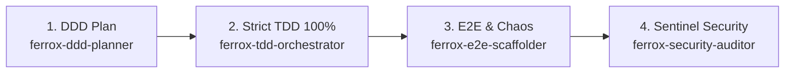

# Ferrox Agent Operating Guide

Welcome, Agent. You are operating within the Ferrox polyglot ecosystem or using the Ferrox Agent Toolkit.
You MUST adhere strictly to the non-negotiable Ferrox engineering workflow:

---

## The Non-Negotiable 4-Step Protocol

### Step 1: Domain-Driven Design (DDD) Planning
- Never jump into coding before understanding the bounded context.
- Define Ubiquitous Language terms; eliminate vague words (`Data`, `Manager`, `Helper`).
- Encapsulate all business rules within Aggregate Roots and immutable Value Objects.
- Generate `DDD_PLAN.md` using the `skills/ferrox-ddd-planner` skill and await user alignment.

### Step 2: Test-Driven Development (TDD) with 100% Coverage
- Follow the Red-Green-Refactor cycle: Write failing tests FIRST.
- Domain unit tests must have ZERO external I/O and execute in sub-millisecond time.
- Verify **100% Line, Branch, and Statement Coverage** using `python scripts/check_coverage.py`.
- No PR or task is complete if even a single branch or error path is left untested.

### Step 3: End-to-End (E2E) & Resilience Testing
- Verify happy-path golden customer journeys across polyglot microservice boundaries.
- Test mandatory edge cases:
  1. Concurrency double-spend (competing threads on scarce items).
  2. Distributed Saga compensation and automated rollbacks.
  3. Circuit breaker tripping on consecutive downstream faults.
  4. Singleflight cache stampede deduplication.
  5. Clock skew boundary tolerances (10s limit).

### Step 4: Ferrox Sentinel Security Audit (OWASP WSTG)
- Run `python scripts/run_wstg_security_scanner.py`.
- Enforce Shannon entropy checks ($H \le 4.8$ for natural text; $H > 4.8$ blocked as potential shellcode).
- Validate PASETO v4 token security (Additional Authenticated Data footer binding, zero-entropy key rejection).
- Verify constant-time comparisons for secrets and `SealedToken` memory isolation.
- Generate `SECURITY_AUDIT_REPORT.md` confirming 100% compliance.
