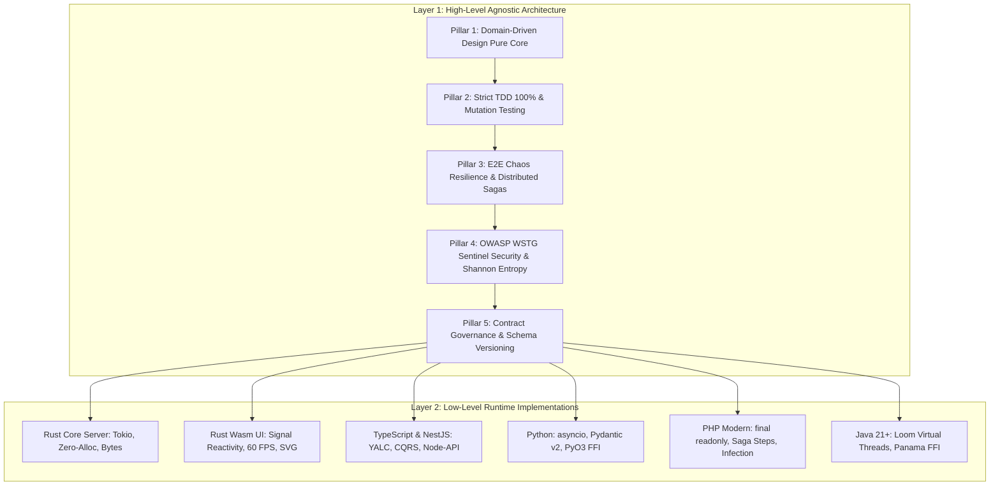

# Ferrox Engineering Master Handbook: Dual-Layer Polyglot Architecture

This handbook is the authoritative engineering specification for building, testing, and securing systems across the Ferrox polyglot ecosystem (Rust, Rust Wasm, TypeScript/NestJS, Python, PHP, Java 21 Loom & Panama).

---

## 1. The Dual-Layer Architecture

The Ferrox Engineering Standard operates across two strictly separated, complementary layers:

---

## 2. Layer 1: High-Level Agnostic Pillars

### Pillar 1: Pure Domain-Driven Design (DDD)
- **Pure Domain Core**: The domain core contains business entities, value objects, domain events, and repository ports. It has **zero imports** from database libraries (TypeORM, Hibernate, SQLx), web frameworks (NestJS, Spring, Axum), or external serialization.
- **Aggregate Roots as Consistency Boundaries**: Aggregate roots are the sole entry point for mutating internal entities. State transitions must satisfy domain invariants atomically. External references hold only the aggregate's strongly typed ID.
- **Value Objects**: Immutable and self-validating. Invalid state is rejected at construction time. Structural equality guarantees that two value objects with identical fields are equal.
- **CQRS**: Commands express intent to mutate state and return `Result<Id, DomainError>`. Queries project read-only datasets and never mutate state.

### Pillar 2: Strict TDD, 100% Coverage & Mutation Testing
- **Red-Green-Refactor**: Production code is written only to make a previously failing test pass.
- **Execution Speed**: Pure domain tests must run completely in-memory in under 5 milliseconds.
- **100% Coverage Mandate**: 100% Line, Branch, and Function coverage enforced via `check_coverage.py`.
- **Mutation Testing**: Critical domain packages must achieve $\ge 85\%$ Mutation Score Indicator (MSI) using language mutation engines (`cargo mutants`, `stryker`, `infection`, `pitest`, `mutmut`), proving that tests detect and kill intentional code mutants.

### Pillar 3: E2E Chaos Resilience & Distributed Sagas
- **Distributed Saga Pattern**: Multi-service transactions coordinate forward actions and backward compensating actions. If any step fails, previous steps are automatically rolled back.
- **Transactional Outbox Pattern**: Aggregate state updates and event publishing occur in a single atomic database transaction. An outbox relay guarantees at-least-once delivery to message brokers.
- **Concurrency & Double-Spend Defense**: Finite resources (stock, seats, account balances) are guarded by Redis Redlock or database row locks (`SELECT ... FOR UPDATE`).
- **Singleflight Deduplication**: High-traffic read operations coalesce simultaneous identical requests into 1 execution, eliminating cache stampedes.
- **Circuit Breaker Fail-Fast**: Outbound dependencies trip from `CLOSED` to `OPEN` on consecutive faults, failing fast in sub-15ms without saturating worker threads.

### Pillar 4: Ferrox Sentinel Security (OWASP WSTG v4.2 / v5.0)
- **Shannon Entropy Inspection**:
  $$H = - \sum_{i=1}^{n} P(c_i) \log_2 P(c_i)$$
  Natural text scores $H \le 4.2$. Payloads exceeding $H > 4.8$ (obfuscated shellcode, polymorphic scripts, C2 beacons) are intercepted and rejected with HTTP 403 RFC 7807.
- **PASETO v4 Cryptographic Hardening**:
  * Weak / zero-entropy 256-bit symmetric keys rejected at boot.
  * Footers authenticated via Additional Authenticated Data (AAD) in XChaCha20-Poly1305.
  * Clock skew leeway strictly bounded to 10 seconds.
- **Constant-Time Operations**: Secret comparisons use constant-time algorithms to eliminate timing side channels.
- **SSRF & ReDoS Defense**: Prohibit private IP/loopback fetching; eliminate catastrophic regex backtracking.

### Pillar 5: API & Contract Governance
- **Protobuf v3 & gRPC**: Schemas versioned in canonical repository with `buf lint` and `buf breaking` checks.
- **CloudEvents v1.0**: Standardized JSON/Protobuf envelopes for asynchronous messaging across Kafka, NATS, and Redis Streams.
- **RFC 7807 Problem Details**: Standardized HTTP error format across all REST endpoints.

---

## 3. Layer 2: Polyglot Implementation Matrix

| Concept | Rust Core Server | Rust Wasm UI | TypeScript / NestJS | Python | PHP Modern | Java 21+ |
| :--- | :--- | :--- | :--- | :--- | :--- | :--- |
| **Value Object** | `struct Newtype(T)` | `struct Newtype(T)` | `class` with `readonly` | Frozen Pydantic v2 | `final readonly class` | Java `record` |
| **Aggregate** | Struct with private state | `Signal<ComponentState>` | `@AggregateRoot()` class | Dataclass + private fields | Aggregate Root class | Class + typed UUID |
| **Domain Event**| `pub enum DomainEvent` | Reactive Signal dispatch | Class extending `DomainEvent` | Frozen Pydantic model | `DomainEventInterface` | `sealed interface` |
| **Repository** | `pub trait Repo: Send+Sync`| In-memory store / IndexedDB | Abstract class port | `typing.Protocol` | `interface RepoInterface` | `public interface Repo` |
| **Concurrency** | Tokio async / channels | Event loop / AnimationFrame| Async/Await Promises | `asyncio` / AnyIO | RoadRunner / Swoole workers | Virtual Threads (Loom) |
| **Native Interop**| Native C-ABI (`extern "C"`) | `wasm-bindgen` / `web-sys` | Node-API (`napi-rs`) | PyO3 (GIL release) | `ext-php-rs` / FFI | Panama (`Arena`, `Segment`) |
| **Mutation Tool**| `cargo mutants` | Headless Wasm tests | `npx stryker run` | `mutmut run` | `vendor/bin/infection` | `mvn pitest:mutationCoverage`|

---

## 4. Low-Level Implementation Idioms by Language

### 4.1 🦀 Rust Core Server (`ferrox`, `ferrox-core`)
- Target: 1,000,000 RPS with sub-millisecond p99 latency.
- Memory: Zero-alloc slicing with `bytes::Bytes`, arena allocators (`bumpalo`), cache-line alignment `#[repr(align(64))]`.
- Concurrency: Tokio async runtime, lock-free queues (`crossbeam`), read-heavy `arc_swap::ArcSwap`.
- Safety: `#![forbid(unsafe_code)]`, zero `unwrap()`/`expect()`, typed errors via `thiserror`.

### 4.2 🎨 Rust WebAssembly UI (`ferrox-front`, `ferrox-codex`)
- Zero Virtual DOM and zero Node.js runtime dependencies.
- Fine-grained reactivity powered by `Signal<T>` and `create_effect`.
- 60 FPS rendering budget (<16.6ms frame budget).
- High-performance dark-mode SVG vector rendering for charts and Mermaid diagrams.
- Binary size optimization: `opt-level = 'z'`, LTO, and `wasm-opt -Oz`.

### 4.3 ⚡ TypeScript & NestJS (`nestjs-yalc`, `ferrox-node`)
- Modular Hexagonal Onion Architecture conforming to YALC standards.
- CQRS Command and Query separation via `@CommandHandler()` and `@QueryHandler()`.
- High-speed FFI connection to Rust core via Node-API (`napi-rs`).
- Strict typing (`noImplicitAny`, `strictNullChecks`), Zod/Class-Validator schemas, RFC 7807 global exception filters.

### 4.4 🐍 Python (`ferrox-py`)
- Modern Python 3.12+ with PEP 695 type parameter syntax and `mypy --strict`.
- Frozen Pydantic v2 value objects and domain entities.
- High-performance native extensions via PyO3 with explicit GIL release (`py.allow_threads`).
- Non-blocking `asyncio` execution, Redis Redlock mutual exclusion, and property-based testing (`hypothesis`).

### 4.5 🐘 PHP Modern (`ferrox-php`)
- PHP 8.4: `declare(strict_types=1);`, `final readonly class`, typed enums, union/intersection types.
- Distributed Saga Orchestration: `SagaStepInterface` with forward `execute()` and backward `compensate()`.
- Static analysis at PHPStan Level 9 and Infection mutation testing ($\ge 85\%$ MSI).
- PSR-7/15 HTTP middleware pipeline with PASETO v4 token verification.

### 4.6 ☕ Java 21+ (`ferrox-java`)
- Project Loom: One Virtual Thread per request (`Executors.newVirtualThreadPerTaskExecutor()`).
- Structured Concurrency: `StructuredTaskScope.ShutdownOnFailure` for coordinated async fan-outs.
- Project Panama: Zero-copy native FFI to Rust core via `Arena.ofConfined()` and `MemorySegment`.
- Immutable domain models using Java Records and Sealed Interface Algebraic Data Types.
- Architectural boundary enforcement with ArchUnit tests.
