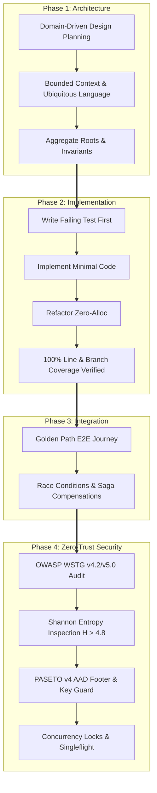

# Ferrox Engineering Master Handbook: DDD, TDD, E2E & Sentinel Security

This handbook is the authoritative engineering standard for building, testing, and securing services across the Ferrox polyglot ecosystem (Rust, Rust Wasm, TypeScript/NestJS, Python, Java 21 Loom, PHP).

---

## 1. Architectural Philosophy: The 4-Pillar Pipeline

Every feature, module, or service delivered in the Ferrox ecosystem must traverse four disciplined phases:

---

## 2. Pillar 1: Domain-Driven Design (DDD)

### 2.1 The Pure Domain Invariant
The domain core must never contain infrastructure code. No database queries, no HTTP controllers, no framework annotations (such as TypeORM or Hibernate). Repositories are expressed strictly as domain interfaces/traits.

### 2.2 Aggregate Roots as Consistency Guardians
- An Aggregate Root is the sole gatekeeper of its inner state.
- Invariants must hold true before and after any public method execution.
- External references must only hold the Aggregate's strongly typed ID (`OrderId`, `UserId`).

### 2.3 Value Objects
- **Immutability**: Once created, state cannot change.
- **Self-Validation**: Invariants are asserted in constructors/factories; invalid instances cannot exist.
- **Structural Equality**: Equality is based on value attributes, not identity pointer.

### 2.4 Polyglot Mapping Table
| Construct | Rust | TypeScript (`nestjs-yalc`) | Python (`ferrox-py`) | Java (`ferrox-java`) | PHP (`ferrox-php`) |
| :--- | :--- | :--- | :--- | :--- | :--- |
| **Value Object** | `struct Newtype(T)` | Immutable class | Frozen Pydantic v2 | Java 21 `record` | `final readonly class` |
| **Aggregate** | Struct with private state | `@AggregateRoot()` class | Dataclass + private fields | Domain Class + UUID | Aggregate Root class |
| **Domain Event** | Enum / typed struct | Class extending `DomainEvent` | Frozen Pydantic model | `sealed interface` | `DomainEventInterface` |
| **Repository** | `pub trait Repo: Send + Sync`| Abstract class port | `typing.Protocol` | `public interface Repo` | `interface RepoInterface` |

---

## 3. Pillar 2: Strict TDD & 100% Code Coverage

### 3.1 The Red-Green-Refactor Cycle
1. **Red**: Write a test testing an invariant. Execute the test and watch it fail.
2. **Green**: Implement the simplest production code to make the test pass.
3. **Refactor**: Eliminate duplication, optimize allocations, and align with idiomatic idioms.
4. **Coverage Audit**: Execute `python scripts/check_coverage.py`. Enforce **100% line coverage and 100% branch coverage**.

### 3.2 Mocking Boundaries
- **Rule**: Mock only external ports (network APIs, queues, databases). Never mock domain entities, value objects, or private internal methods.
- **Speed**: Domain unit tests must execute in under 5 milliseconds.

---

## 4. Pillar 3: End-to-End (E2E) & Chaos Resilience

### 4.1 Golden Path Verification
Verify complete customer journeys across all polyglot microservice boundaries from ingress to database commit and event bus publication.

### 4.2 Mandatory Chaos Tests
1. **Concurrency Double-Spend**: 20 threads simultaneously purchasing the last 3 inventory items. Exactly 3 succeed; 17 receive HTTP 409 Conflict.
2. **Distributed Saga Compensation**: Mid-transaction failure triggers backward compensating transactions, leaving zero orphaned reservations.
3. **Circuit Breaker Tripping**: 5 consecutive downstream timeouts trip state to `OPEN`, immediately returning fail-fast errors without thread starvation.
4. **Singleflight Deduplication**: 50 concurrent requests for an uncached item coalesce into exactly 1 backend query.
5. **Clock Skew Tolerance**: Tokens expiring within 10 seconds leeway are accepted; tokens beyond 10s are rejected.

---

## 5. Pillar 4: Ferrox Sentinel Security (OWASP WSTG)

### 5.1 Shannon Entropy Inspection
Shannon entropy measures information density in bits per character:
$$H = - \sum_{i=1}^{n} P(c_i) \log_2 P(c_i)$$

- Natural language and standard query strings typically score $H \le 4.2$.
- Obfuscated shellcode, polymorphic payloads, and encrypted strings exhibit high randomness ($H > 4.8$).
- The Sentinel Threat Filter blocks requests exceeding $H > 4.8$ with HTTP 403 Forbidden.

### 5.2 PASETO v4 Cryptographic Hardening
- **Zero-Entropy Key Rejection**: Symmetric 256-bit keys with low entropy or repeated bytes are rejected at boot.
- **Authenticated Footers**: PASETO v4 local tokens authenticate the footer via Additional Authenticated Data (AAD) in XChaCha20-Poly1305. Tampered footers trigger decryption failure.
- **Clock Skew Leeway**: Strict verification of `exp` and `nbf` claims with a 10-second limit.

### 5.3 Concurrency & Lock Audits
- Distributed operations on shared state must acquire a Redis Redlock or database row lock (`SELECT ... FOR UPDATE`).
- High-frequency read queries must use a `SingleflightController` to eliminate thundering herd attacks.

### 5.4 Constant-Time Execution & Memory Bounds
- All secret and hash comparisons must use constant-time algorithms to eliminate timing side channels.
- Sensitive credentials must be wrapped in `SealedToken` abstractions that zeroize memory upon drop.

---

## 6. Polyglot Inter-Language Connectors

1. **In-Process Zero-Copy FFI**:
   - Rust exports functions via `extern "C"` C-ABI.
   - Java 21 Project Panama binds off-heap buffers via `Arena` and `MemorySegment`.
   - Python binds via PyO3 with GIL release (`py.allow_threads`).
   - Node binds via `napi-rs` with `BufferSlice`.
2. **Synchronous RPC**:
   - gRPC over HTTP/2 with Protocol Buffers v3 defined in canonical `CONNECTOR_CONTRACT.proto`.
3. **Asynchronous Messaging**:
   - CloudEvents v1.0 standard JSON/Protobuf envelopes on Kafka, NATS JetStream, or Redis Streams.
