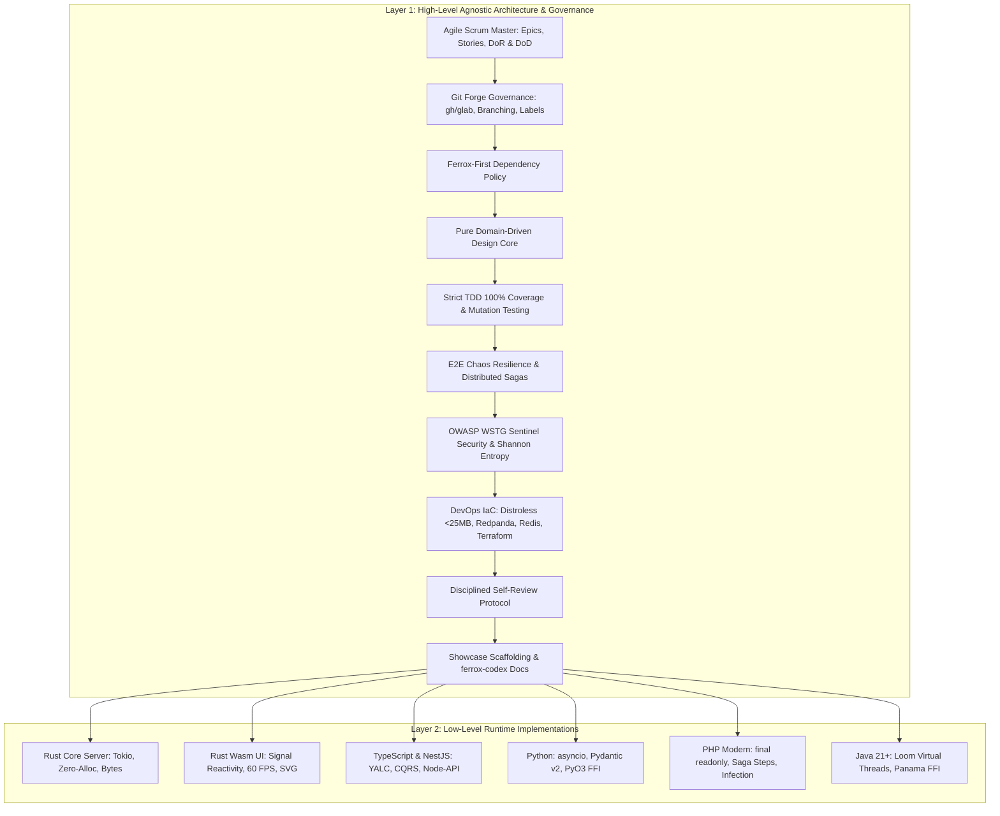

# Ferrox Engineering Master Handbook: Dual-Layer Polyglot Architecture & Agile Governance

This handbook is the authoritative engineering specification for building, testing, securing, and deploying enterprise systems across the Ferrox polyglot ecosystem (Rust, Rust Wasm, TypeScript/NestJS, Python, PHP, Java 21 Loom & Panama).

---

## 1. The Dual-Layer Architecture

The Ferrox Engineering Standard operates across two strictly separated, complementary tiers:

---

## 2. Layer 1: High-Level Agnostic Pillars

### Pillar 1: Agile Scrum Lifecycle (DoR & DoD)
- **Hierarchical Sizing**: Epics $\to$ User Stories $\to$ Atomic Tasks (1 task = 1 branch = 1 PR).
- **Definition of Ready (DoR)**: Bounded context, ubiquitous language, aggregate invariants, value objects, and Protobuf/CloudEvents schemas must be documented in `DDD_PLAN.md` before coding starts.
- **Definition of Done (DoD)**: TDD red-green-refactor, 100% coverage, mutation tests passed ($\ge 85\%$ MSI), OWASP WSTG 100%, E2E chaos verified, self-review approved, and docs compiled on `ferrox-codex`.

### Pillar 2: Ferrox-First Dependency Policy
- **Priority**: Adopt native Ferrox crates (`ferrox`, `ferrox-front`, `ferrox-codex`, `ferrox-py-auth`, `nestjs-yalc`) first.
- **Justification**: Any external dependency requires a formal audit documenting license compatibility, zero-alloc impact, and maintenance health, encapsulated behind an isolated domain port.

### Pillar 3: Remote Forge Governance & CodeRabbit
- **Branching**: `feature/issue-<id>-<slug>`, `bugfix/issue-<id>-<slug>` branching off `origin/master`.
- **Labels**: Standard taxonomy (`area:*`, `type:*`, `ddd:verified`, `tdd:100-percent`, `security:wstg-pass`, `review:self-reviewed`, `status:ready-for-merge`).
- **CodeRabbit**: Automated AI code review using `.coderabbit.yaml` in assertive mode enforcing Ferrox idioms.

### Pillar 4: Pure Domain-Driven Design (DDD)
- **Domain Core**: Pure business logic with zero framework or ORM imports.
- **Aggregates**: Guard invariants atomically; external systems hold only strongly typed IDs.
- **Value Objects**: Immutable and self-validating with structural equality.

### Pillar 5: Strict TDD, 100% Coverage & Mutation Testing
- **Red-Green-Refactor**: Unit tests written first; domain unit tests execute in $< 5\text{ms}$.
- **100% Coverage**: Verified by `check_coverage.py` across lines and branches.
- **Mutation Testing**: All critical domain modules must score $\ge 85\%$ MSI (`cargo mutants`, `stryker`, `infection`, `pitest`, `mutmut`).

### Pillar 6: E2E Chaos Resilience & Distributed Sagas
- **Distributed Saga**: Multi-service transactions with forward execution and automated backward compensation.
- **Transactional Outbox**: Atomic database state update and event publishing in a single transaction.
- **Concurrency & Double-Spend**: Protected by Redis Redlock and SQL row locks.
- **Singleflight**: Coalesces concurrent read bursts on uncached items into 1 upstream query.
- **Circuit Breaker**: Trips to `OPEN` on consecutive faults, failing fast in sub-15ms.

### Pillar 7: Ferrox Sentinel Security (OWASP WSTG v4.2 / v5.0)
- **Shannon Entropy Filter**: Payload entropy $H > 4.8$ flagged and blocked with HTTP 403.
- **PASETO v4 Hardening**: Additional Authenticated Data footer binding, zero-entropy key rejection, and 10s clock skew tolerance.
- **Constant-Time Execution**: Secret comparisons immune to side-channel timing attacks.
- **SSRF & ReDoS Defense**: Private IP range blacklisting and linear-time regex execution.

### Pillar 8: DevOps Infrastructure & IaC
- **Distroless Containerization**: Multi-stage Dockerfiles based on `gcr.io/distroless/cc-debian12`, non-root execution, read-only rootfs, size $< 25\text{MB}$.
- **Redpanda & Kafka**: Zero-JVM event broker with sub-millisecond latency.
- **Redis Sentinel & Redlock**: High-availability caching and distributed locking.
- **Terraform IaC**: Infrastructure provisioning for bare-metal VPS (Hetzner) and Cloud (AWS/GCP).

### Pillar 9: Disciplined Self-Review Protocol
- **Diff Inspection**: `git diff origin/master...HEAD` scanned via `scan_diff_debris.py`.
- **Zero Debris**: Elimination of `dbg!`, `console.log`, `print()`, `var_dump()`, or temporary files before opening PR.

### Pillar 10: Interactive Documentation on Ferrox-Codex
- Documentation, architecture diagrams, and live WebAssembly interactive sandboxes built with `ferrox-front` and served natively via `ferrox-codex`.

---

## 3. Polyglot Matrix & Low-Level Runtime Guidelines

| Concept | Rust Core Server | Rust Wasm UI | TypeScript / NestJS | Python | PHP Modern | Java 21+ |
| :--- | :--- | :--- | :--- | :--- | :--- | :--- |
| **Value Object** | `struct Newtype(T)` | `struct Newtype(T)` | `class` with `readonly` | Frozen Pydantic v2 | `final readonly class` | Java `record` |
| **Aggregate** | Struct with private state | `Signal<ComponentState>` | `@AggregateRoot()` class | Dataclass + private fields | Aggregate Root class | Class + typed UUID |
| **Domain Event**| `pub enum DomainEvent` | Reactive Signal dispatch | Class extending `DomainEvent` | Frozen Pydantic model | `DomainEventInterface` | `sealed interface` |
| **Repository** | `pub trait Repo: Send+Sync`| In-memory store / IndexedDB | Abstract class port | `typing.Protocol` | `interface RepoInterface` | `public interface Repo` |
| **Concurrency** | Tokio async / channels | Event loop / AnimationFrame| Async/Await Promises | `asyncio` / AnyIO | RoadRunner / Swoole workers | Virtual Threads (Loom) |
| **Native Interop**| Native C-ABI (`extern "C"`) | `wasm-bindgen` / `web-sys` | Node-API (`napi-rs`) | PyO3 (GIL release) | `ext-php-rs` / FFI | Panama (`Arena`, `Segment`) |
| **Mutation Tool**| `cargo mutants` | Headless Wasm tests | `npx stryker run` | `mutmut run` | `vendor/bin/infection` | `mvn pitest:mutationCoverage`|
