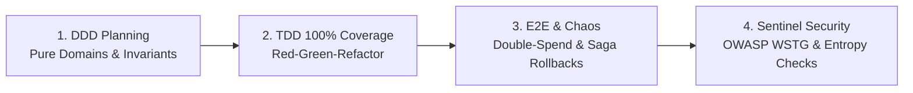

# 🛡️ Ferrox Agent Toolkit

> **Enterprise AI Agent Toolkit for the Ferrox Polyglot Ecosystem.**  
> Optimized for Domain-Driven Design (DDD), strict Test-Driven Development (TDD) enforcing 100% test coverage, End-to-End (E2E) chaos resilience, and OWASP WSTG Security Sentinel auditing across **Rust, Rust Wasm, TypeScript/NestJS, Python, Java 21 Loom, and PHP**.

[](https://ferrox-rust.dev)
[](LICENSE)
[](skills/ferrox-security-auditor)
[](skills/ferrox-tdd-orchestrator)
[](rules/ferrox-polyglot-paradigms.md)

---

## 🌟 Overview

The **Ferrox Agent Toolkit** transforms AI pair programmers into disciplined, domain-aware senior software engineers. Built specifically for the high-performance demands of the Ferrox ecosystem (targeting 1 Million RPS, zero-alloc Rust cores, and reactive WebAssembly microfrontends), this toolkit enforces four unyielding engineering pillars:



---

## 📚 Toolkit Architecture

### 1. Governing Rules (`rules/`)
Always-on architectural guidelines loaded into the agent's context window:
- **[`rules/ferrox-ddd-architecture.md`](rules/ferrox-ddd-architecture.md)**: Strict Domain-Driven Design, pure business cores, ubiquitous language, and CQRS separation.
- **[`rules/ferrox-tdd-100-percent.md`](rules/ferrox-tdd-100-percent.md)**: Non-negotiable Red-Green-Refactor protocol with 100% line and branch coverage requirement.
- **[`rules/ferrox-e2e-contract-testing.md`](rules/ferrox-e2e-contract-testing.md)**: Full golden-path journeys, concurrency race conditions, and distributed saga compensation testing.
- **[`rules/ferrox-sentinel-security.md`](rules/ferrox-sentinel-security.md)**: Zero-trust security sentinel conforming to OWASP WSTG v4.2/v5.0, Shannon entropy filtering ($H > 4.8$), and PASETO v4 crypto verification.
- **[`rules/ferrox-polyglot-paradigms.md`](rules/ferrox-polyglot-paradigms.md)**: Idioms for Rust Core, Rust Wasm Frontend, NestJS-Yalc, Python Asyncio, Java 21 Loom, and PHP Sagas.
- **[`rules/ferrox-interop-connectors.md`](rules/ferrox-interop-connectors.md)**: In-process zero-copy FFI (Project Panama, PyO3, Node-API), gRPC/Protobuf, and CloudEvents streaming.

---

### 2. Actionable Skills (`skills/`)
On-demand procedures triggered by the agent or user:
- **[`skills/ferrox-ddd-planner`](skills/ferrox-ddd-planner)**: Decomposes requirements into bounded contexts, aggregate invariants, and produces `DDD_PLAN.md`.
- **[`skills/ferrox-tdd-orchestrator`](skills/ferrox-tdd-orchestrator)**: Guides the TDD loop and enforces 100% test coverage using the universal coverage checker.
- **[`skills/ferrox-e2e-scaffolder`](skills/ferrox-e2e-scaffolder)**: Scaffolds end-to-end integration journeys, race condition fuzzers, and chaos rollback tests.
- **[`skills/ferrox-security-auditor`](skills/ferrox-security-auditor)**: Automated penetration testing scanner checking entropy, PASETO v4 tampering, race conditions, and rate limits.
- **[`skills/ferrox-polyglot-connector`](skills/ferrox-polyglot-connector)**: Generates and tests cross-language FFI bindings, gRPC contracts, and event schemas.
- **[`skills/ferrox-code-reviewer`](skills/ferrox-code-reviewer)**: Reviews pull requests across DDD purity, TDD coverage, security compliance, and zero-alloc performance.
- **[`skills/ferrox-workflow-handoff`](skills/ferrox-workflow-handoff)**: Consolidates decisions, test proofs, and audit reports into production handoff artifacts (`HANDOFF.md`).

---

### 3. Specialized Subagents (`agents/`)
Specialized system prompts and role descriptions:
- **`ferrox-architect-ddd`**: Lead Domain Modeler and Bounded Context Architect.
- **`ferrox-tdd-engineer`**: Red-Green-Refactor master and 100% Coverage Guardian.
- **`ferrox-security-sentinel`**: Penetration tester and OWASP WSTG Security Auditor.
- **`ferrox-e2e-resilience`**: End-to-end integration and chaos resilience specialist.
- **`ferrox-connector-specialist`**: Cross-language FFI, Panama, and gRPC systems engineer.

---

## 🛠️ Included CLI Tools

The toolkit bundles standalone Python CLI tools for continuous integration and automated verification:

### 1. Universal 100% Coverage Enforcer (`check_coverage.py`)
Parses LCOV (`lcov.info`), Cobertura/Clover (`coverage.xml`), JaCoCo (`jacoco.xml`), and JSON reports:
```bash
python scripts/check_coverage.py --target 100
```

### 2. OWASP WSTG Security Sentinel Scanner (`run_wstg_security_scanner.py`)
Automated penetration tests testing Shannon entropy, recursive canonicalization, PASETO v4 tamper checks, and concurrency locks:
```bash
python scripts/run_wstg_security_scanner.py
```

### 3. Toolkit Self-Verification Test Suite (`verify_toolkit.py`)
Verifies the integrity of all manifests, skills, frontmatter headers, and rules:
```bash
python scripts/verify_toolkit.py
```

---

## 🚀 Installation & Setup

### Installing for Google Antigravity IDE (Recommended)
Run the Windows PowerShell installer:
```powershell
.\scripts\install.ps1
```
Or on Linux/macOS:
```bash
./scripts/install.sh
```
This automatically links the plugin into `~/.gemini/config/plugins/ferrox-agent-toolkit`, making all skills and rules immediately active in Antigravity.

### Installing for Claude Code
Add to your project's `.claude-plugin/` or run:
```bash
cp -r skills/* ~/.claude/skills/
cp -r rules/* ~/.claude/rules/
```

---

## 📖 The Ferrox Handbook
For the complete, in-depth architectural guide, read **[`HANDBOOK.md`](HANDBOOK.md)**.

---

## 📄 License
Licensed under the [MIT License](LICENSE). Copyright (c) 2026 Ferrox Team.
