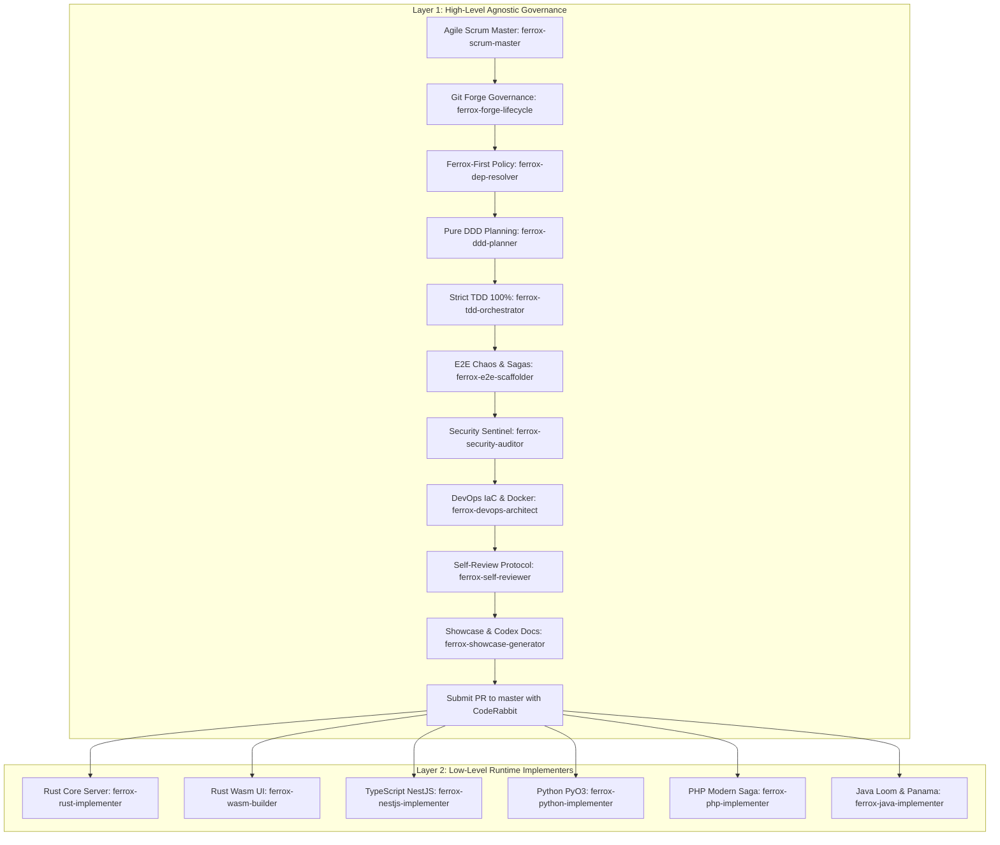

# 🛡️ Ferrox Agent Toolkit

> **Enterprise Dual-Layer AI Agent Toolkit for the Ferrox Polyglot Ecosystem.**  
> Governed by the **Ferrox Master Orchestrator**, this toolkit combines high-level Agile Scrum, Ferrox-First dependency resolution, pure DDD planning, strict TDD with 100% coverage, OWASP WSTG Sentinel Security, E2E Chaos Resilience, DevOps IaC (<25MB distroless, Redpanda, Redis Redlock, Terraform), and remote forge governance (`gh`/`glab` + CodeRabbit) across **Rust Core, Rust Wasm, TypeScript/NestJS, Python, PHP, and Java 21 Loom/Panama**.

[](https://ferrox-rust.dev)
[](LICENSE)
[](skills/ferrox-security-auditor)
[](skills/ferrox-tdd-orchestrator)
[](HANDBOOK.md)

---

## 🌟 The Dual-Layer Architecture



---

## 📚 Complete Toolkit Catalog

### 1. Governing Rules (19 Rules in [`rules/`](rules/))

#### A. High-Level Agnostic Governance Rules
- **[`rules/ferrox-agile-scrum-lifecycle.md`](rules/ferrox-agile-scrum-lifecycle.md)**: Hierarchical decomposition (Epic $\to$ Story $\to$ Task), Definition of Ready (DoR), and Definition of Done (DoD) quality gates.
- **[`rules/ferrox-first-dependency-policy.md`](rules/ferrox-first-dependency-policy.md)**: Mandatory prioritization of native Ferrox packages and formal justification checklist for third-party libraries.
- **[`rules/ferrox-git-lifecycle-governance.md`](rules/ferrox-git-lifecycle-governance.md)**: Git branching model, `gh`/`glab` CLI integration, standard label taxonomy, and PR targeting `master` with auto-closing issues.
- **[`rules/ferrox-self-review-standards.md`](rules/ferrox-self-review-standards.md)**: Fresh-context diff inspection, elimination of debug debris (`dbg!`, `console.log`, `var_dump`), domain purity, and zero-alloc audit.
- **[`rules/ferrox-devops-infrastructure-iac.md`](rules/ferrox-devops-infrastructure-iac.md)**: Multi-stage distroless containers (<25MB), Redpanda/Kafka event streaming, Redis Redlock HA, and Terraform VPS/Cloud provisioning.
- **[`rules/ferrox-ddd-architecture.md`](rules/ferrox-ddd-architecture.md)**: Pure domain cores, aggregate roots, immutable value objects, ubiquitous language, and CQRS separation.
- **[`rules/ferrox-tdd-100-percent.md`](rules/ferrox-tdd-100-percent.md)**: Strict Red-Green-Refactor, 100% line & branch coverage enforcement, sub-5ms domain test execution, and mutation testing ($\ge 85\%$ MSI).
- **[`rules/ferrox-e2e-chaos-resilience.md`](rules/ferrox-e2e-chaos-resilience.md)**: Distributed Saga compensation, Transactional Outbox pattern, idempotency keys, singleflight deduplication, and circuit breakers.
- **[`rules/ferrox-sentinel-security.md`](rules/ferrox-sentinel-security.md)**: Zero-trust OWASP WSTG v4.2/v5.0, Shannon entropy inspection ($H > 4.8$), PASETO v4 AAD footer binding, and SSRF/ReDoS/SQLi defense.
- **[`rules/ferrox-contract-governance.md`](rules/ferrox-contract-governance.md)**: Protobuf v3 schemas with `buf breaking` checks, CloudEvents v1.0 standard envelopes, and OpenAPI 3.1.
- **[`rules/ferrox-interop-connectors.md`](rules/ferrox-interop-connectors.md)**: Cross-language communication standard (native zero-copy FFI, gRPC, and event queues).
- **[`rules/ferrox-polyglot-paradigms.md`](rules/ferrox-polyglot-paradigms.md)**: Ecosystem overview of runtime conventions.
- **[`rules/ferrox-e2e-contract-testing.md`](rules/ferrox-e2e-contract-testing.md)**: End-to-end integration and resilience testing standards.

#### B. Low-Level Runtime Guidelines
- **[`rules/ferrox-rust-guidelines.md`](rules/ferrox-rust-guidelines.md)**: Tokio async runtime, pinning, `bytes::Bytes`, zero-alloc arenas, lock-free structures, `#![forbid(unsafe_code)]`, and `thiserror`.
- **[`rules/ferrox-wasm-guidelines.md`](rules/ferrox-wasm-guidelines.md)**: Zero Node.js, zero Virtual DOM, fine-grained `Signal<T>` reactivity, 60 FPS rendering budget, dark-mode SVG graphics, and `wasm-opt`.
- **[`rules/ferrox-typescript-nestjs-guidelines.md`](rules/ferrox-typescript-nestjs-guidelines.md)**: YALC modular architecture, CQRS CommandBus/QueryBus, Node-API (`napi-rs`) native bridges, strict TypeScript, and RFC 7807 exception filters.
- **[`rules/ferrox-python-pyo3-guidelines.md`](rules/ferrox-python-pyo3-guidelines.md)**: Python 3.12+, native PyO3 extensions with GIL release (`py.allow_threads`), frozen Pydantic v2 models, `asyncio`, and property testing (`hypothesis`).
- **[`rules/ferrox-php-guidelines.md`](rules/ferrox-php-guidelines.md)**: PHP 8.4 `final readonly`, backed enums, Saga step interfaces with backward compensation, PSR-7/14/15 compliance, PHPStan Level 9, and Infection mutation tests.
- **[`rules/ferrox-java-loom-panama-guidelines.md`](rules/ferrox-java-loom-panama-guidelines.md)**: Virtual Threads (Project Loom), Structured Concurrency, Project Panama zero-copy off-heap FFI (`Arena`, `MemorySegment`), Java Records/Sealed ADTs, and ArchUnit architecture tests.

---

### 2. Actionable Skills (19 Skills in [`skills/`](skills/))

#### A. Governance, DevOps & Showcase Skills
- **[`skills/ferrox-scrum-master`](skills/ferrox-scrum-master)**: Decomposes briefs into Epics, Stories, and Atomic Tasks with DoR and DoD gates (`AGILE_SPRINT_BACKLOG.md`).
- **[`skills/ferrox-dep-resolver`](skills/ferrox-dep-resolver)**: Resolves and injects native Ferrox dependencies across polyglot manifests (`resolve_ferrox_deps.py`).
- **[`skills/ferrox-forge-lifecycle`](skills/ferrox-forge-lifecycle)**: Automates `gh`/`glab` Milestones, Issues, branches, `.coderabbit.yaml`, and PR submission targeting `master`.
- **[`skills/ferrox-self-reviewer`](skills/ferrox-self-reviewer)**: Performs fresh-eyes pre-submission diff audits eliminating debug code (`scan_diff_debris.py`).
- **[`skills/ferrox-devops-architect`](skills/ferrox-devops-architect)**: Scaffolds distroless Dockerfiles (<25MB), Redpanda & Redis docker-compose, and Terraform VPS/Cloud modules.
- **[`skills/ferrox-showcase-generator`](skills/ferrox-showcase-generator)**: Scaffolds complete end-to-end applications with reactive Wasm UI and `ferrox-codex` documentation.

#### B. Agnostic Architecture & Quality Skills
- **[`skills/ferrox-ddd-planner`](skills/ferrox-ddd-planner)**: Decomposes requirements into bounded contexts, aggregate invariants, and produces `DDD_PLAN.md`.
- **[`skills/ferrox-tdd-orchestrator`](skills/ferrox-tdd-orchestrator)**: Guides the TDD loop and enforces 100% test coverage using `check_coverage.py`.
- **[`skills/ferrox-e2e-scaffolder`](skills/ferrox-e2e-scaffolder)**: Scaffolds end-to-end integration journeys, race condition fuzzers, and chaos rollback tests.
- **[`skills/ferrox-security-auditor`](skills/ferrox-security-auditor)**: Automated penetration testing scanner checking entropy, PASETO v4 tampering, and rate limits.
- **[`skills/ferrox-polyglot-connector`](skills/ferrox-polyglot-connector)**: Generates and tests cross-language FFI bindings, gRPC contracts, and event schemas.
- **[`skills/ferrox-code-reviewer`](skills/ferrox-code-reviewer)**: Reviews pull requests across DDD purity, TDD coverage, security compliance, and zero-alloc performance.
- **[`skills/ferrox-workflow-handoff`](skills/ferrox-workflow-handoff)**: Consolidates decisions, test proofs, and audit reports into production handoff artifacts (`HANDOFF.md`).

#### C. Low-Level Runtime Implementer Skills
- **[`skills/ferrox-rust-implementer`](skills/ferrox-rust-implementer)**: Builds Tokio async services, lock-free structures, and `thiserror` hierarchies in Rust.
- **[`skills/ferrox-wasm-builder`](skills/ferrox-wasm-builder)**: Compiles fine-grained reactive Signal components, SVG diagrams, and optimizes Wasm binaries.
- **[`skills/ferrox-nestjs-implementer`](skills/ferrox-nestjs-implementer)**: Implements YALC NestJS modules, CQRS handlers, and Node-API native Rust bindings.
- **[`skills/ferrox-python-implementer`](skills/ferrox-python-implementer)**: Builds Python 3.12+ `asyncio` services, frozen Pydantic v2 schemas, and PyO3 native extensions with GIL release.
- **[`skills/ferrox-php-implementer`](skills/ferrox-php-implementer)**: Implements modern PHP 8.4 services, distributed Saga steps, and PHPStan Level 9 checks.
- **[`skills/ferrox-java-implementer`](skills/ferrox-java-implementer)**: Implements Java 21+ services with Project Loom Virtual Threads and Project Panama off-heap FFI.

---

### 3. Specialized Agent Roster (10 Agents in [`agents/`](agents/))

- **`ferrox-master-orchestrator`**: Agile Scrum Master, pipeline director, and lifecycle governor.
- **`ferrox-devops-deployer`**: Distroless containers (<25MB), Redpanda/Kafka, Redis Redlock, and Terraform.
- **`ferrox-quality-gatekeeper`**: Fresh-eyes diff audit, DoD verification, CodeRabbit config, and PR submission.
- **`ferrox-architect-ddd`**: Pure domain modeler, aggregate invariants, and CQRS architect.
- **`ferrox-tdd-engineer`**: Red-Green-Refactor master, sub-5ms tests, and 100% coverage guardian.
- **`ferrox-security-sentinel`**: Penetration tester, Shannon entropy, PASETO v4, and OWASP WSTG auditor.
- **`ferrox-qa-chaos-engineer`**: Concurrency double-spend, distributed Saga compensations, and chaos tester.
- **`ferrox-rust-specialist`**: High-performance Rust systems engineer (1M RPS, zero-alloc).
- **`ferrox-wasm-specialist`**: Reactive WebAssembly pure UI architect (Signal, 60 FPS, SVG).
- **`ferrox-polyglot-implementer`**: Cross-language FFI (Panama, PyO3, Node-API) and gRPC/CloudEvents engineer.

---

## 🛠️ Included CLI Tools

The toolkit bundles standalone Python CLI tools for continuous integration and automated verification:

1. **Universal 100% Coverage Enforcer (`check_coverage.py`)**:
   ```bash
   python scripts/check_coverage.py --target 100
   ```
2. **OWASP WSTG Security Sentinel Scanner (`run_wstg_security_scanner.py`)**:
   ```bash
   python scripts/run_wstg_security_scanner.py
   ```
3. **Diff Debris Scanner (`scan_diff_debris.py`)**:
   ```bash
   python skills/ferrox-self-reviewer/scripts/scan_diff_debris.py
   ```
4. **Ferrox-First Dependency Auditor (`resolve_ferrox_deps.py`)**:
   ```bash
   python skills/ferrox-dep-resolver/scripts/resolve_ferrox_deps.py
   ```
5. **Toolkit Self-Verification Test Suite (`verify_toolkit.py`)**:
   ```bash
   python scripts/verify_toolkit.py
   ```

---

## 🚀 Installation & Sync

Run the Windows PowerShell installer:
```powershell
.\scripts\install.ps1
```
Or on Linux/macOS:
```bash
./scripts/install.sh
```
This automatically links and refreshes the plugin in `~/.gemini/config/plugins/ferrox-agent-toolkit`.

---

## 📄 License
Licensed under the [MIT License](LICENSE). Copyright (c) 2026 Ferrox Team.
