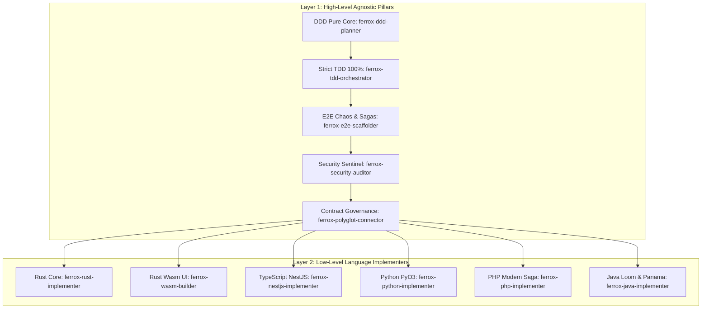

# 🛡️ Ferrox Agent Toolkit

> **Enterprise Dual-Layer AI Agent Toolkit for the Ferrox Polyglot Ecosystem.**  
> Optimized for Domain-Driven Design (DDD), strict Test-Driven Development (TDD) enforcing 100% test coverage with mutation testing, E2E chaos resilience with Distributed Sagas, and OWASP WSTG Security Sentinel auditing across **Rust Core, Rust Wasm, TypeScript/NestJS, Python, PHP, and Java 21 Loom/Panama**.

[](https://ferrox-rust.dev)
[](LICENSE)
[](skills/ferrox-security-auditor)
[](skills/ferrox-tdd-orchestrator)
[](HANDBOOK.md)

---

## 🌟 The Dual-Layer Architecture

The **Ferrox Agent Toolkit** operates across two complementary tiers:
1. **Layer 1: High-Level Agnostic Architecture**: Universal engineering standards applicable to any service regardless of language (Pure DDD, Strict TDD with 100% coverage and mutation testing, E2E Chaos Resilience with Distributed Sagas & Outbox, OWASP WSTG Sentinel Security with Shannon entropy, and Contract Governance).
2. **Layer 2: Low-Level Language Implementers**: Concrete, zero-alloc, idiom-optimized rules and skills that translate architectural models into idiomatic code across all 6 Ferrox runtimes.



---

## 📚 Toolkit Catalog

### 1. High-Level Agnostic Rules ([`rules/`](rules/))
- **[`rules/ferrox-ddd-architecture.md`](rules/ferrox-ddd-architecture.md)**: Pure domain cores, aggregate roots, immutable value objects, ubiquitous language, and CQRS separation.
- **[`rules/ferrox-tdd-100-percent.md`](rules/ferrox-tdd-100-percent.md)**: Strict Red-Green-Refactor, 100% line/branch coverage enforcement, sub-5ms domain test execution, and mutation testing ($\ge 85\%$ MSI).
- **[`rules/ferrox-e2e-chaos-resilience.md`](rules/ferrox-e2e-chaos-resilience.md)**: Distributed Saga compensation, Transactional Outbox pattern, idempotency keys, singleflight deduplication, and circuit breakers.
- **[`rules/ferrox-sentinel-security.md`](rules/ferrox-sentinel-security.md)**: Zero-trust OWASP WSTG v4.2/v5.0, Shannon entropy inspection ($H > 4.8$), PASETO v4 AAD footer binding, and SSRF/ReDoS/SQLi defense.
- **[`rules/ferrox-contract-governance.md`](rules/ferrox-contract-governance.md)**: Protobuf v3 schemas with `buf breaking` checks, CloudEvents v1.0 standard envelopes, and OpenAPI 3.1.
- **[`rules/ferrox-interop-connectors.md`](rules/ferrox-interop-connectors.md)**: Cross-language communication standard (native zero-copy FFI, gRPC, and event queues).
- **[`rules/ferrox-polyglot-paradigms.md`](rules/ferrox-polyglot-paradigms.md)**: High-level overview of language conventions across the ecosystem.

---

### 2. Low-Level Runtime Guidelines ([`rules/`](rules/))
- **[`rules/ferrox-rust-guidelines.md`](rules/ferrox-rust-guidelines.md)**: Tokio async runtime, pinning, `bytes::Bytes`, zero-alloc arenas, lock-free structures, `#![forbid(unsafe_code)]`, and `thiserror`.
- **[`rules/ferrox-wasm-guidelines.md`](rules/ferrox-wasm-guidelines.md)**: Zero Node.js, zero Virtual DOM, fine-grained `Signal<T>` reactivity, 60 FPS rendering budget, dark-mode SVG graphics, and `wasm-opt`.
- **[`rules/ferrox-typescript-nestjs-guidelines.md`](rules/ferrox-typescript-nestjs-guidelines.md)**: YALC modular architecture, CQRS CommandBus/QueryBus, Node-API (`napi-rs`) native bridges, strict TypeScript, and RFC 7807 exception filters.
- **[`rules/ferrox-python-pyo3-guidelines.md`](rules/ferrox-python-pyo3-guidelines.md)**: Python 3.12+, native PyO3 extensions with GIL release (`py.allow_threads`), frozen Pydantic v2 models, `asyncio`, and property testing (`hypothesis`).
- **[`rules/ferrox-php-guidelines.md`](rules/ferrox-php-guidelines.md)**: PHP 8.4 `final readonly`, backed enums, Saga step interfaces with backward compensation, PSR-7/14/15 compliance, PHPStan Level 9, and Infection mutation tests.
- **[`rules/ferrox-java-loom-panama-guidelines.md`](rules/ferrox-java-loom-panama-guidelines.md)**: Virtual Threads (Project Loom), Structured Concurrency, Project Panama zero-copy off-heap FFI (`Arena`, `MemorySegment`), Java Records/Sealed ADTs, and ArchUnit architecture tests.

---

### 3. Actionable Skills ([`skills/`](skills/))

#### A. High-Level Agnostic Skills
- **[`skills/ferrox-ddd-planner`](skills/ferrox-ddd-planner)**: Decomposes requirements into bounded contexts, aggregate invariants, and produces `DDD_PLAN.md`.
- **[`skills/ferrox-tdd-orchestrator`](skills/ferrox-tdd-orchestrator)**: Guides the TDD loop and enforces 100% test coverage using the universal coverage checker.
- **[`skills/ferrox-e2e-scaffolder`](skills/ferrox-e2e-scaffolder)**: Scaffolds end-to-end integration journeys, race condition fuzzers, and chaos rollback tests.
- **[`skills/ferrox-security-auditor`](skills/ferrox-security-auditor)**: Automated penetration testing scanner checking entropy, PASETO v4 tampering, race conditions, and rate limits.
- **[`skills/ferrox-polyglot-connector`](skills/ferrox-polyglot-connector)**: Generates and tests cross-language FFI bindings, gRPC contracts, and event schemas.
- **[`skills/ferrox-code-reviewer`](skills/ferrox-code-reviewer)**: Reviews pull requests across DDD purity, TDD coverage, security compliance, and zero-alloc performance.
- **[`skills/ferrox-workflow-handoff`](skills/ferrox-workflow-handoff)**: Consolidates decisions, test proofs, and audit reports into production handoff artifacts (`HANDOFF.md`).

#### B. Low-Level Runtime Implementer Skills
- **[`skills/ferrox-rust-implementer`](skills/ferrox-rust-implementer)**: Builds Tokio async services, lock-free structures, and `thiserror` hierarchies in Rust.
- **[`skills/ferrox-wasm-builder`](skills/ferrox-wasm-builder)**: Compiles fine-grained reactive Signal components, SVG diagrams, and optimizes Wasm binaries.
- **[`skills/ferrox-nestjs-implementer`](skills/ferrox-nestjs-implementer)**: Implements YALC NestJS modules, CQRS handlers, and Node-API native Rust bindings.
- **[`skills/ferrox-python-implementer`](skills/ferrox-python-implementer)**: Builds Python 3.12+ `asyncio` services, frozen Pydantic v2 schemas, and PyO3 native extensions with GIL release.
- **[`skills/ferrox-php-implementer`](skills/ferrox-php-implementer)**: Implements modern PHP 8.4 services, distributed Saga steps, and PHPStan Level 9 checks.
- **[`skills/ferrox-java-implementer`](skills/ferrox-java-implementer)**: Implements Java 21+ services with Project Loom Virtual Threads and Project Panama off-heap FFI.

---

### 4. Specialized Agent Roster ([`agents/`](agents/))

- **`ferrox-architect-ddd`**: Lead Domain Modeler and Bounded Context Architect.
- **`ferrox-tdd-engineer`**: Red-Green-Refactor master and 100% Coverage Guardian.
- **`ferrox-security-sentinel`**: Penetration tester and OWASP WSTG Security Auditor.
- **`ferrox-qa-chaos-engineer`**: Distributed resilience, race conditions, and Saga compensations tester.
- **`ferrox-rust-specialist`**: High-performance Rust systems engineer (1M RPS, zero-alloc).
- **`ferrox-wasm-specialist`**: Reactive WebAssembly pure UI architect (Signal, 60 FPS, SVG).
- **`ferrox-polyglot-implementer`**: Cross-language FFI (Panama, PyO3, Node-API) and gRPC/CloudEvents engineer.

---

## 🛠️ Included CLI Tools

The toolkit bundles standalone Python CLI tools for continuous integration and automated verification:

### 1. Universal 100% Coverage Enforcer (`check_coverage.py`)
Parses LCOV (`lcov.info`), Cobertura/Clover (`coverage.xml`), JaCoCo (`jacoco.xml`), and JSON reports:
```bash
python scripts/check_coverage.py --target 100
```

### 2. OWASP WSTG Security Sentinel Scanner (`run_wstg_security_scanner.py`)
Automated penetration tests testing Shannon entropy, recursive canonicalization, PASETO v4 tamper checks, and concurrency locks:
```bash
python scripts/run_wstg_security_scanner.py
```

### 3. Toolkit Self-Verification Test Suite (`verify_toolkit.py`)
Verifies the integrity of all manifests, skills, frontmatter headers, rules, and JSON schemas:
```bash
python scripts/verify_toolkit.py
```

---

## 🚀 Installation & Setup

### Installing for Google Antigravity IDE (Recommended)
Run the Windows PowerShell installer:
```powershell
.\scripts\install.ps1
```
Or on Linux/macOS:
```bash
./scripts/install.sh
```
This automatically links the plugin into `~/.gemini/config/plugins/ferrox-agent-toolkit`, making all skills and rules immediately active in Antigravity.

---

## 📖 The Ferrox Handbook
For the complete, in-depth architectural guide, read **[`HANDBOOK.md`](HANDBOOK.md)**.

---

## 📄 License
Licensed under the [MIT License](LICENSE). Copyright (c) 2026 Ferrox Team.
