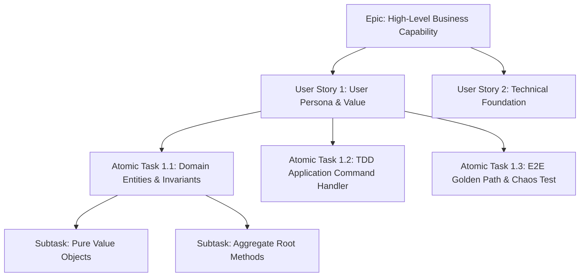
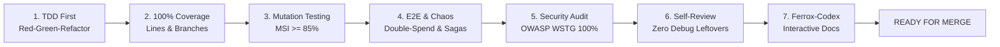

# Ferrox Agile Scrum Lifecycle & Quality Gates Standard

This rule defines the operational Agile/Scrum workflow for AI agents and engineering teams in the Ferrox ecosystem, enforcing strict quality gates from ticket inception to production readiness.

---

## 1. Hierarchical Decomposition Protocol

Every application brief, user request, or feature roadmap must be hierarchically decomposed before implementation:

1. **Epic**: Broad architectural capability (e.g. `Order Placement & Realtime Fulfillment Engine`).
2. **User Story**: Persona-centric value statement (`As a merchant, I want atomic inventory reservation so that overselling is prevented`).
3. **Atomic Task**: Self-contained piece of engineering work sized to be implemented, tested, and reviewed within an isolated Git branch (`Implement InventoryAggregate with concurrency Redlock`).
4. **Subtask**: Granular unit test or refactoring step within an atomic task.

---

## 2. Definition of Ready (DoR) Gate

An atomic task or user story **cannot enter implementation** until all DoR criteria are satisfied and documented in `DDD_PLAN.md`:

- [ ] **Bounded Context Clarified**: Upstream and downstream dependencies mapped.
- [ ] **Ubiquitous Language Defined**: No ambiguous terms (`Data`, `Manager`, `Helper`).
- [ ] **Aggregate Invariants Specified**: Explicit pre-conditions, post-conditions, and state transitions.
- [ ] **Value Objects Formulated**: Immutable attributes and validation rules specified.
- [ ] **API/Event Contract Ready**: Protobuf v3, CloudEvents, or OpenAPI schema defined.
- [ ] **Ferrox-First Policy Verified**: Checked against native Ferrox packages; zero unjustified third-party dependencies.
- [ ] **Acceptance Criteria (Gherkin)**: `Given-When-Then` criteria clearly stated.

---

## 3. Definition of Done (DoD) Gate

No code may be marked complete, and no Pull Request may be merged to `master`/`main` until all DoD criteria are satisfied and verified by automated tools:

1. **TDD Compliance**: All unit tests written prior to production code; zero-I/O domain tests execute in $< 5\text{ms}$.
2. **100% Coverage Enforced**: Verified by `python scripts/check_coverage.py --target 100` (zero uncovered lines or branches).
3. **Mutation Testing Passed**: Verified by mutation tools (`cargo mutants`, `stryker`, `infection`, `pitest`, `mutmut`) with $\ge 85\%$ Mutation Score Indicator.
4. **E2E Resilience Verified**: Happy path journey and all 6 mandatory chaos scenarios (double-spend, saga compensation, circuit breakers, singleflight, clock skew, idempotency) logged in `E2E_VERIFICATION.md`.
5. **OWASP WSTG Security Audit**: 100% pass score on `python scripts/run_wstg_security_scanner.py` logged in `SECURITY_AUDIT_REPORT.md`.
6. **Self-Review Completed**: Clean `git diff` with zero `dbg!`, `console.log`, `var_dump`, or temporary files.
7. **Ferrox-Codex Documentation**: Architectural diagrams, API specs, and interactive sandboxes documented and verified on `ferrox-codex`.
