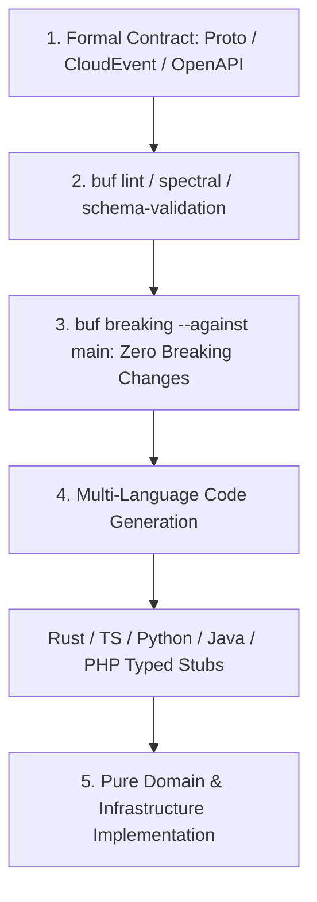

# Ferrox API & Schema Contract Governance Standard

This governing rule defines contract design, versioning, serialization, and backward compatibility standards across all APIs, gRPC services, and event streams in the Ferrox polyglot ecosystem.

---

## 1. The Contract-First Philosophy

In a polyglot microservices mesh, **code does not define the contract; the contract defines the code**. No endpoint or event topic may be implemented before its schema is formally specified, reviewed, and versioned.



---

## 2. Protocol Buffers v3 & gRPC Governance

### A. Schema Structure & Organization
- Canonical directory: `contracts/proto/dev/ferrox/<bounded_context>/<version>/`.
- Package naming: `dev.ferrox.<domain>.<version>` (e.g. `dev.ferrox.orders.v1`).
- File naming: `<entity>.proto`, `<service>_service.proto`.

### B. Compatibility & Immutability Rules
1. **Never reuse or modify a field number**: Once a field number is assigned to a field name and type, it can never be changed or reassigned.
2. **Deprecation Protocol**: To deprecate a field, mark it `[deprecated = true];`. When removing a field, declare its number and name as `reserved` to prevent accidental reuse:
   ```protobuf
   reserved 4, 7 to 9;
   reserved "old_customer_tax_code";
   ```
3. **Automated CI Breaking Check**: Every pull request modifying `.proto` files must run:
   ```bash
   buf lint
   buf breaking --against ".git#branch=main"
   ```
   Any breaking change (e.g. changing field type, removing non-reserved field, changing package) fails the CI pipeline immediately.

---

## 3. Asynchronous Event Governance (CloudEvents v1.0)

All domain events published across messaging brokers (Kafka, NATS JetStream, Redis Streams) must strictly conform to the **CNCF CloudEvents v1.0** specification:

### Standard Envelope Attributes
```json
{
  "specversion": "1.0",
  "id": "urn:uuid:018f3a5e-9a1b-7123-8c4d-ef0123456789",
  "source": "urn:ferrox:service:orders",
  "type": "dev.ferrox.orders.OrderCreated.v1",
  "subject": "order_01HZX876ABC",
  "time": "2026-10-18T10:30:00.000Z",
  "datacontenttype": "application/json",
  "data": {
    "order_id": "order_01HZX876ABC",
    "customer_id": "cust_998811",
    "total_amount": "149.99",
    "currency": "EUR"
  }
}
```

### Event Naming Conventions
- `type` follows reverse-DNS dot notation: `dev.ferrox.<context>.<Entity><ActionInPastTense>.<version>`.
- Examples: `dev.ferrox.commerce.PaymentCaptured.v1`, `dev.ferrox.inventory.StockReserved.v2`.

---

## 4. REST & OpenAPI 3.1 Governance

1. **RFC 7807 Problem Details**: All HTTP error responses must return `application/problem+json` containing `type`, `title`, `status`, `detail`, and `instance`.
2. **Schema Validation**: Ingress controllers must validate incoming payloads against OpenAPI 3.1 / Zod / Pydantic schemas before dispatching to application command handlers.
3. **Pagination Standard**: Cursor-based pagination (`cursor`, `limit`, `has_more`, `next_cursor`) for unbounded collections; avoid SQL `OFFSET` on high-traffic tables.
