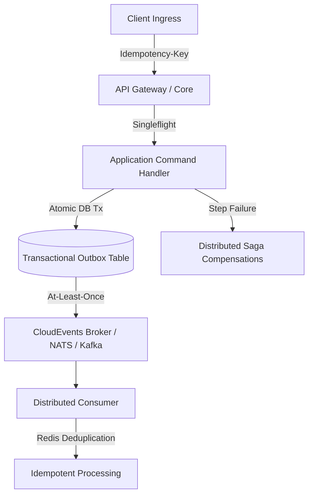

# Ferrox End-to-End (E2E) & Chaos Resilience Standard

This governing rule defines the mandatory resilience, distributed transactions, fault injection, and concurrency standards across all Ferrox distributed services.

---

## 1. The Distributed Consistency & Resilience Invariant

In high-throughput polyglot microservice environments, network failures, node crashes, and concurrent requests are inevitable. Every service participating in multi-step business transactions must guarantee **eventual consistency, zero data corruption, and graceful degradation**.

---

## 2. Mandatory Architectural Patterns

### A. Distributed Saga Pattern (Forward & Compensating Actions)
- Any transaction spanning more than one database or microservice boundary must be structured as an **Orchestrated or Choreographed Saga**.
- **Every step $S_i$ must define a forward action $E_i$ and an automated compensating action $C_i$**:
  * Example: Step 1 `ReserveInventory` $\to$ Compensating action: `CancelInventoryReservation`.
  * Step 2 `AuthorizePayment` $\to$ Compensating action: `VoidPaymentAuthorization`.
- If Step $k$ fails after retries, the Saga Coordinator executes $C_{k-1}, C_{k-2}, \dots, C_1$ in reverse order to return the system to a clean state.
- **Verification Rule**: E2E suites must inject synthetic faults at each step to prove automated compensation without human intervention.

### B. Transactional Outbox Pattern
- Services must **never** execute a database commit and publish a message broker event in separate, uncoordinated operations (dual-write problem).
- Events must be written atomically to an `outbox` table within the same ACID database transaction that updates aggregate state.
- A reliable background relay (e.g., CDC via Debezium or poller) delivers outbox records to the message broker with at-least-once delivery guarantees.

### C. Idempotency Keys & Deduplication
- All non-idempotent mutating endpoints (`POST`, `PATCH`) must support an `Idempotency-Key` header (UUIDv4/v7).
- Request fingerprints and responses must be cached in Redis with an explicit TTL (minimum 24 hours).
- Replayed identical requests return the cached result immediately without re-executing business logic.

### D. Singleflight Deduplication Controller
- Protect downstream systems from **cache stampedes (thundering herds)**.
- When an eviction occurs on high-traffic read models, concurrent requests for the same key must be coalesced into **exactly 1 execution**. All waiting callers receive the shared resolved promise/future.

### E. Circuit Breaker Fault Isolation
- External network calls must be wrapped in a Circuit Breaker (e.g. threshold: 5 consecutive timeouts or 50% error rate).
- State transitions:
  * `CLOSED`: Normal operation.
  * `OPEN`: Immediately fails fast without allocating network sockets or blocking worker threads.
  * `HALF-OPEN`: Probes downstream health with a single canary request before closing.

---

## 3. Mandatory Chaos & Concurrency Test Scenarios

Every feature verification suite must execute these automated tests in continuous integration:

| Scenario | Injected Condition | Expected Behavior | Violation Consequence |
| :--- | :--- | :--- | :--- |
| **Double-Spend Concurrency** | 20 threads simultaneously purchasing the last 3 items | Exactly 3 succeed; 17 receive 409 Conflict | Overselling / Financial loss |
| **Saga Rollback Injection** | Injected failure at payment step | Inventory reservation automatically undone | Orphaned reservations |
| **Outbox Relay Crash** | Relay killed mid-stream | On restart, all pending outbox events published | Data inconsistency across services |
| **Network Partition / Slowdowns** | Injected 5000ms latency on downstream dependencies | Downstream calls abort at timeout budget; circuit trips OPEN | Thread starvation / Cascading crash |
| **Duplicate Event Ingestion** | Event bus publishes duplicate message | Consumer detects seen `event_id`, skips execution with 200 OK | Duplicate fulfillment / Double refunds |

---

## 4. CI Enforcers & Automated Execution

- Integration suites must run against real ephemeral dependencies using `testcontainers` or Docker Compose profiles.
- Tests must assert deterministic cleanup and zero leftover database rows after each test run.
