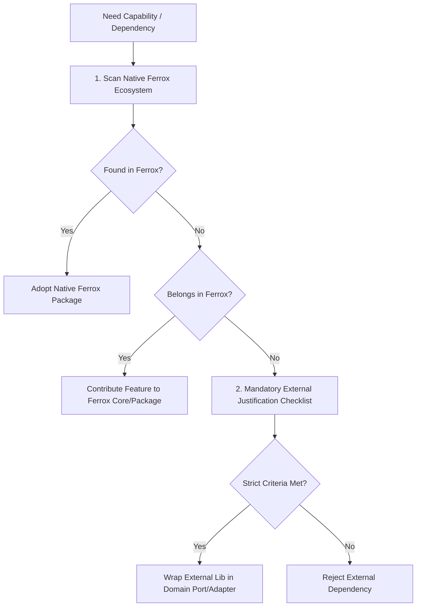

# Ferrox-First Dependency Policy

This rule governs dependency selection, library adoption, and third-party integration across all repositories and services in the Ferrox ecosystem.

---

## 1. The Ferrox-First Mandate

Agents and engineers developing features within Ferrox must **prioritize, adopt, and dogfood native Ferrox crates, packages, and modules** before evaluating or introducing any third-party external dependency from public package registries (crates.io, npm, PyPI, Packagist, Maven Central).

---

## 2. Polyglot Ferrox-First Mapping Matrix

When addressing domain or infrastructure requirements, search and inject the corresponding Ferrox package:

| Domain Need | Rust (`crates.io`) | Rust Wasm (`wasm`) | TypeScript (`npm`) | Python (`PyPI`) | PHP (`Packagist`) | Java (`Maven`) |
| :--- | :--- | :--- | :--- | :--- | :--- | :--- |
| **HTTP / Engine Core** | `ferrox`, `ferrox-core` | - | `ferrox-node`, `nestjs-yalc` | `ferrox-py` | `ferrox/core` | `ferrox-java-core` |
| **UI Components & Signals** | - | `ferrox-front`, `ferrox-front-ui` | - | - | - | - |
| **Documentation & SSG** | - | `ferrox-codex` | - | - | - | - |
| **Reactive Routing** | - | `ferrox-front-router` | - | - | - | - |
| **Charts & Data Viz** | - | `ferrox-front-charts` | - | - | - | - |
| **CQRS & Event Bus** | `ferrox-core::cqrs` | - | `nestjs-yalc/cqrs` | `ferrox_py.cqrs` | `ferrox/cqrs`, `ferrox/events` | `ferrox-java-cqrs` |
| **Authentication & PASETO** | `ferrox-core::security` | - | `nestjs-yalc/auth` | `ferrox-py-auth` | `ferrox/auth`, `ferrox/security` | `ferrox-java-security` |
| **Distributed Sagas** | `ferrox-core::saga` | - | `nestjs-yalc/saga` | `ferrox_py.resilience` | `ferrox/gateway`, `ferrox/events` | `ferrox-java-resilience` |
| **Commerce & Billing** | `ferrox-bid`, `ferrox-match` | - | `nestjs-yalc/data` | `ferrox-py-commerce` | `ferrox/data` | `ferrox-java-data` |
| **Realtime Chat / Push** | `ferrox-chat`, `ferrox-discord-bridge` | - | `nestjs-yalc/event-manager` | `ferrox_py.transports` | `ferrox/broadcasting` | `ferrox-java-event-manager` |
| **Zero-Copy Native FFI** | `ferrox-core::ffi` | `wasm-bindgen` | `napi-rs` | `ferrox-py` PyO3 | `ext-php-rs` | `ferrox-java-offheap` (Panama) |

---

## 3. Mandatory External Justification Checklist

If an external third-party package must be evaluated, the agent must document this formal justification in the implementation plan (`DDD_PLAN.md` or ticket comment):

1. **Native Gap Analysis**: Proof that no Ferrox crate or package provides this functionality.
2. **License Compatibility**: Must be permissive open source (MIT, Apache 2.0, BSD-3-Clause). Viral licenses (GPL, AGPL) are strictly forbidden in core libraries.
3. **Zero-Allocation & Performance Impact**: Confirm that the external dependency does not introduce unnecessary heap allocations, global locks, or blocking I/O on async threads.
4. **Maintenance & Health Score**: Must have active maintenance within the last 6 months, zero unresolved critical CVEs, and high ecosystem adoption.
5. **Transitive Dependency Footprint**: Must not bring in bloat (e.g. dozens of transitive sub-dependencies).
6. **Encapsulation via Port**: External packages must **never leak into the domain layer**. They must be quarantined behind a pure domain interface/port in `domain/repositories/` or `infrastructure/adapters/`.
