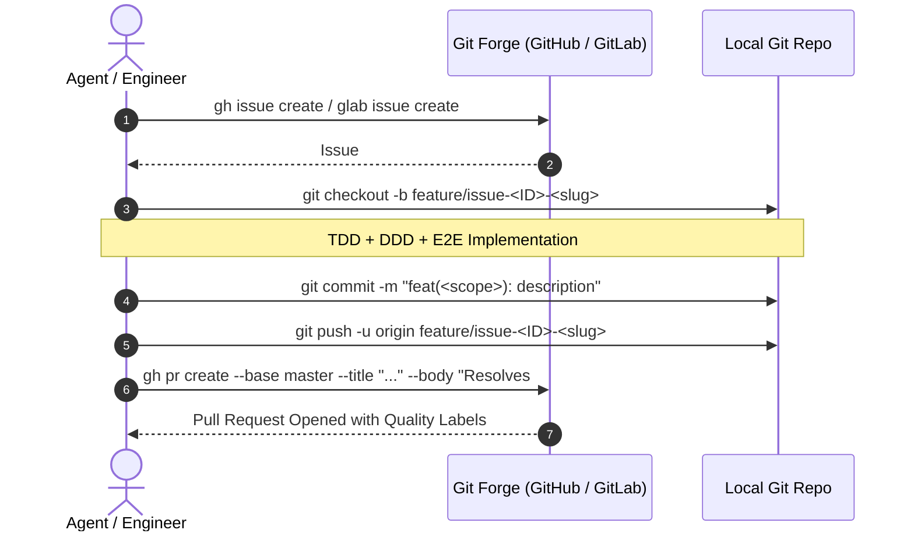

# Ferrox Git Lifecycle & Remote Forge Governance (`gh` / `glab`)

This rule defines the Git branching model, remote forge integration (GitHub / GitLab CLI), issue tracking, label taxonomy, and Pull Request governance across all Ferrox repositories.

---

## 1. Remote Forge CLI Integration (`gh` / `glab`)

Agents must interact directly with the project forge via official CLI tools:
- **GitHub**: `gh`
- **GitLab**: `glab`

---

## 2. Branch Naming Conventions

All working branches must branch off the latest `origin/master` (or `origin/main`) and follow strict semantic naming:

- **Features**: `feature/issue-<id>-<short-kebab-slug>` (e.g. `feature/issue-42-paseto-token-auth`)
- **Bugfixes**: `bugfix/issue-<id>-<short-kebab-slug>` (e.g. `bugfix/issue-109-redlock-timeout-leak`)
- **Refactoring**: `refactor/issue-<id>-<short-kebab-slug>` (e.g. `refactor/issue-88-zero-alloc-byte-slicing`)
- **DevOps / IaC**: `devops/issue-<id>-<short-kebab-slug>` (e.g. `devops/issue-15-distroless-dockerfile`)

Direct commits to `master` or `main` are strictly prohibited; all changes land via reviewed Pull Requests.

---

## 3. Mandatory Label Taxonomy

Every Issue and Pull Request must be annotated with labels across the three governance axes:

### Axis 1: Functional Area (`area:*`)
- `area:backend` — Rust server, TypeScript NestJS, Python asyncio, Java, PHP.
- `area:frontend` — Rust Wasm, ferrox-front, UI components, Signal reactivity.
- `area:devops` — Docker distroless, Docker Compose, Kafka, Redis, Terraform.
- `area:docs` — ferrox-codex interactive documentation and architecture specs.
- `area:security` — PASETO crypto, Sentinel filters, OWASP WSTG hardening.

### Axis 2: Work Type (`type:*`)
- `type:feature` — New business capability or domain aggregate.
- `type:bugfix` — Resolution of a defect or invariant violation.
- `type:refactor` — Code cleanup, zero-alloc optimization without behavioral changes.
- `type:test` — Addition of chaos tests, mutation tests, or E2E integration suites.

### Axis 3: Quality Gate Verification (`gate:*`)
- `ddd:verified` — Bounded context and pure invariants certified in `DDD_PLAN.md`.
- `tdd:100-percent` — 100% line & branch coverage confirmed via `check_coverage.py`.
- `security:wstg-pass` — 100% OWASP WSTG pass score in `SECURITY_AUDIT_REPORT.md`.
- `review:self-reviewed` — Pre-submission clean diff audit completed without leftovers.
- `status:ready-for-merge` — All DoD criteria satisfied; ready for final merge to `master`.

---

## 4. Pull Request Protocol Targeting `master`

1. **Auto-Closing Keyword**: The PR body must include `Resolves #<id>` (or `Closes #<id>`) so that the remote forge automatically closes the tracking issue upon merge.
2. **Quality Proofs Embedded**: The PR body must include:
   - TDD coverage table (100% line & branch proof).
   - OWASP WSTG security audit score.
   - Self-Review confirmation checklist.
   - Link to `ferrox-codex` documentation page.
3. **Squash and Merge**: Pull requests must be merged with clean, conventional commit messages (`feat(...)`, `fix(...)`, `refactor(...)`).
