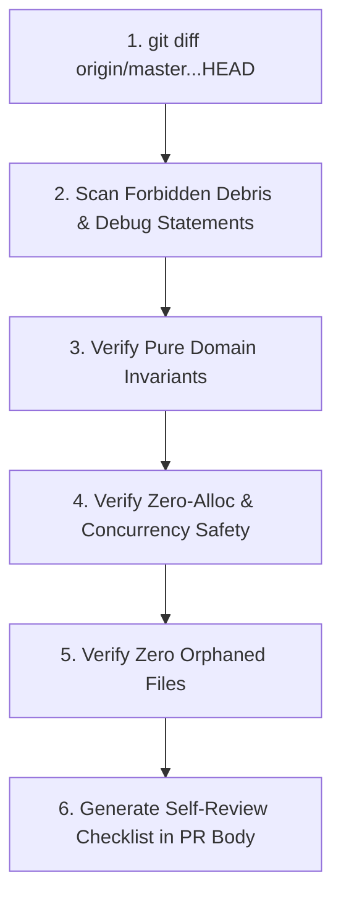

# Ferrox Self-Review Standards (Pre-Submission Audit)

Inspired by the disciplined self-review methodology of `agent-toolkit`, this rule defines the mandatory pre-submission audit an agent or engineer must perform on their own Git diff before opening a Pull Request or asking for human sign-off.

---

## 1. The Fresh-Context Self-Review Protocol

Before committing or pushing final changes, the agent must step back, inspect the complete working diff with "fresh eyes", and verify that every line added is intentional, clean, and free of development debris.

---

## 2. Forbidden Debris Scans (Zero Tolerance)

The working diff must be rigorously searched for development leftovers:

| Language | Forbidden Debug Statement | Permitted Alternative in Production |
| :--- | :--- | :--- |
| **Rust** | `dbg!(...)`, `println!(...)`, `todo!()`, `unimplemented!()`, `#[allow(dead_code)]` | Structured `tracing::debug!(...)` or `tracing::info!(...)` |
| **TypeScript** | `console.log(...)`, `console.debug(...)`, `debugger;`, `// @ts-ignore` | Structured NestJS `LoggerService` |
| **Python** | `print(...)`, `breakpoint()`, `import pdb`, `time.sleep(...)` | Structured `logging.getLogger(...)`, `asyncio.sleep(...)` |
| **PHP** | `var_dump(...)`, `print_r(...)`, `dd(...)`, `dump(...)`, `die(...)` | PSR-3 `LoggerInterface` |
| **Java** | `System.out.println(...)`, `System.err.println(...)`, `e.printStackTrace()` | SLF4J / Logback structured logging |
| **All** | Temporary files (`.tmp`, `.bak`, `.orig`, `scratch/`, test dumps) | Cleaned from working tree and listed in `.gitignore` |

---

## 3. The 4-Point Self-Review Inspection Checklist

Every self-review must answer these four questions affirmatively:

### A. Architectural & Domain Purity
- Does any file in `domain/` import infrastructure frameworks (ORM, HTTP, serialization)?
- Are all Value Objects immutable and guaranteed self-validating?
- Are aggregate state transitions guarded by explicit business invariants?

### B. Test-Driven Verification
- Does every new line of production code map directly to a unit test that was seen failing?
- Does `python scripts/check_coverage.py` report **100.0% line and branch coverage**?
- Have boundary values (zero, negative, max numbers, empty collections, unicode characters) been explicitly exercised?

### C. Zero-Allocation & Performance
- Are there unnecessary memory allocations or buffer clones in hot paths?
- In Rust: are buffers sliced zero-copy via `bytes::Bytes` or `&[u8]`?
- In Wasm: are event listeners and closures properly dropped on component unmount to prevent leaks?
- In Java: are virtual threads free from carrier thread pinning (`synchronized` blocks across I/O)?

### D. Security & Secrets Hygiene
- Are there hardcoded API keys, test passwords, or private certificates in the diff?
- Are all secret comparisons performed in constant time?
- Are sensitive variables cleared upon scope drop (`SealedToken`)?
