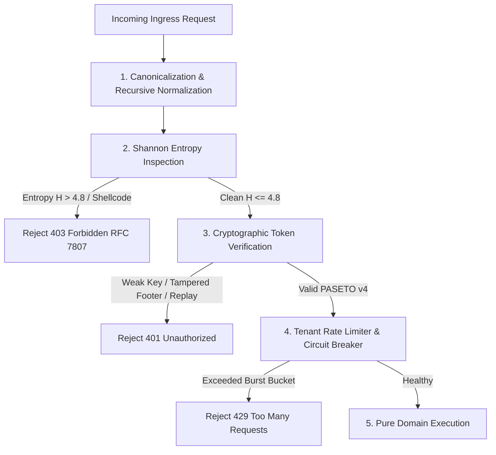

# Ferrox Sentinel Security & Penetration Testing Standard

This rule governs zero-trust security enforcement and automated penetration testing across all services, APIs, and libraries in the Ferrox ecosystem. It conforms to the **OWASP Web Security Testing Guide (WSTG v4.2 / v5.0)** standards.

---

## 1. Zero-Trust Security Sentinel Architecture

All ingress endpoints, connectors, and message consumers must pass through the **Ferrox Sentinel Threat Pipeline** before reaching application logic:

---

## 2. Mandatory OWASP WSTG Audit Vectors

Every security review or CI audit executed by the Security Sentinel agent must audit these 5 threat vectors:

### Vector 1: Input Normalization & Shannon Entropy Fuzzing (WSTG-INPV-01 / WSTG-INPV-05)
- **Recursive Canonicalization**: Ingress parsers must recursively decode payloads (up to 3 levels) to defeat nested URL encoding (`%2527`), Hex obfuscation, and Unicode homoglyphs.
- **Path Traversal Protection**: Any path containing `..`, `..%2f`, or null bytes (`%00`) must be immediately rejected before file or resource resolution.
- **Shannon Entropy Heuristic**:
  $$\text{Entropy } H = - \sum_{i=1}^{n} P(c_i) \log_2 P(c_i)$$
  * Plain text / natural language typically exhibits $H \le 4.2$.
  * Payloads with $H > 4.8$ in standard query strings or text headers must be flagged as potential obfuscated shellcode, polymorphic scripts, or encrypted payloads.

### Vector 2: PASETO v4 Cryptographic Hardening (WSTG-CRYP-01 / WSTG-ATHN-04)
- **Zero-Entropy Symmetric Key Guard**: Rejection at service boot of all 256-bit symmetric keys with repetitive patterns, null bytes (`\x00` * 32), or weak pseudo-random entropy.
- **Authenticated Footer Binding**: In PASETO v4 (`v4.local.<payload>.<footer?>`), the footer is plaintext but authenticated via Additional Authenticated Data (AAD) using XChaCha20-Poly1305. Any token where the footer has been tampered with must fail decryption.
- **Clock Skew & Expiration Boundary**: Strict enforcement of `exp` and `nbf` claims with a maximum clock skew leeway of **10 seconds**. Expired tokens must be immediately revoked.
- **Replay Attack Resistance**: Single-use tokens (such as password reset or transaction approval tokens) must be tracked via short-lived Redis bloom filters or JTI blocklists.

### Vector 3: Concurrency & Business Logic Flaws (WSTG-BUSL-01 / WSTG-BUSL-02)
- **Distributed Locking for Finite Resources**: State mutations involving financial balances, stock inventories, or seat allocations must obtain an atomic distributed lock (Redis Redlock or DB row lock with `SELECT ... FOR UPDATE`).
- **Singleflight Concurrency Controller**: High-frequency expensive operations must be wrapped in a singleflight controller to deduplicate simultaneous requests, preventing thundering herd and cache stampede attacks.

### Vector 4: Rate Limiting & Circuit Breaker DoS Mitigation (WSTG-INPV-08 / WSTG-CLNT-05)
- **Sliding-Window Rate Limiting**: Every API endpoint must enforce rate limits keyed by both IP and Tenant ID. When the bucket limit is exhausted, return `429 Too Many Requests` with a `Retry-After` header.
- **Circuit Breaker Fault Isolation**: External dependencies must be guarded by a circuit breaker (e.g. 5 consecutive timeouts transitions state from `CLOSED` to `OPEN`), returning fail-fast errors instead of thread exhaustion.

### Vector 5: Constant-Time Execution & Memory Bounds (WSTG-CRYP-04)
- **Constant-Time Comparisons**: Token signatures, hashes, and passwords must be compared using constant-time comparison algorithms (`timingSafeEqual` in Node.js, `subtle.constant_time_eq` in Rust, `MessageDigest.isEqual` in Java) to eliminate side-channel timing attacks.
- **Sealed Types & Zero-Allocation Buffers**: Sensitive credentials must be wrapped in zeroize-on-drop abstractions (`SealedToken`), clearing memory buffers immediately upon scope termination.

### Vector 6: Injection, SSRF & ReDoS Mitigations (WSTG-INPV-07 / WSTG-INPV-11)
- **SSRF Defense**: External webhook and URL fetchers must strictly prohibit loopback (`127.0.0.1`, `localhost`), link-local metadata addresses (`169.254.169.254`), and private RFC 1918 IPv4/IPv6 ranges. DNS resolution must be pinned to prevent DNS rebinding attacks.
- **SQLi Elimination**: 100% parameterized queries. Dynamic SQL concatenation is strictly prohibited across all runtimes.
- **ReDoS Elimination**: Regular expressions must avoid catastrophic backtracking (nested quantifiers like `(a+)+$`). Ingress patterns must be pre-compiled with timeout caps (e.g. 50ms) or use linear-time regular expression engines (Rust `regex`, Go `regexp`).

---

## 3. Security Audit Output Artifact

Every security verification executed by the agent must output a structured `SECURITY_AUDIT_REPORT.md` including:
1. Table of WSTG Test IDs evaluated.
2. Status (`PASS` / `FAIL`).
3. Runtime evaluated (`ferrox`, `ferrox-front`, `nestjs-yalc`, `ferrox-py`, `ferrox-java`, `ferrox-php`).
4. Practical Business Risk description.
5. Concrete Remediation diff.

