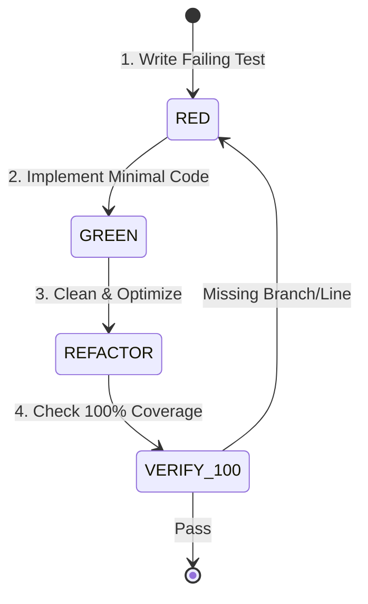
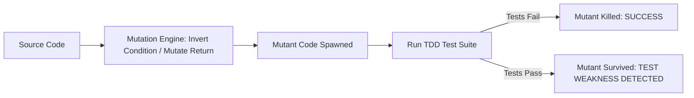

# Ferrox Test-Driven Development (TDD) & 100% Coverage Standard

This rule enforces a strict, non-negotiable Test-Driven Development workflow across the entire Ferrox ecosystem. No production code is merged or considered complete without failing tests written first and verified 100% test coverage.

---

## 1. The Red-Green-Refactor Protocol

Agents MUST follow these three distinct phases sequentially:

1. **Phase 1: RED (Failing Test First)**
   - Before writing any line of application or domain logic, write the test case.
   - Run the test suite and verify that the test fails for the expected reason (e.g., method does not exist or assertion fails).
   - If the test passes before implementation, the test is invalid or redundant.

2. **Phase 2: GREEN (Minimal Code to Pass)**
   - Implement the minimal amount of production code necessary to turn the failing test green.
   - Do not implement hypothetical future requirements or unneeded abstractions.

3. **Phase 3: REFACTOR (Design Excellence & Zero Waste)**
   - Clean up duplication, improve variable naming, align with Ferrox zero-alloc or idiomatic patterns.
   - Verify that all tests remain green without changing test assertions.

4. **Phase 4: 100% COVERAGE VERIFICATION**
   - Run the ecosystem-specific coverage runner.
   - Confirm **100% Line Coverage**, **100% Branch Coverage**, and **100% Function Coverage**.
   - If any branch is missed (e.g., error fallback, boundary check), return to Phase 1 and write a test covering that exact branch.

---

## 2. Test Classification & Mocking Rules

1. **Domain Unit Tests (`test/unit/domain`)**:
   - **Sub-5ms Execution Time**: Every pure domain unit test must execute completely in-memory in under 5 milliseconds. No network, no filesystem, no database.
   - No mock libraries for Domain Entities or Value Objects. Instantiate real instances.
   - Test every domain invariant, invalid argument exception, boundary condition, and domain event emission.

2. **Application Handler Tests (`test/unit/application`)**:
   - Test Command Handlers and Query Handlers in isolation.
   - Mock only outbound Port interfaces (e.g. `UserRepositoryPort`, `EventPublisherPort`, `PaymentGatewayPort`).
   - Verify that the handler loads the aggregate, executes the command, persists through the repository, and publishes domain events.

3. **Boundary Condition Matrix**:
   Every test matrix must cover:
   - Nil / None / Null / Empty strings.
   - Numeric edges: `0`, `-1`, `1`, `MAX_INT`, precision limits for `Decimal` / `f64`.
   - Unicode edge cases: emojis, multibyte UTF-8, zero-width spaces, RTL characters.
   - Clock / Time boundaries: expired timestamps, leap seconds, time zone offsets.

---

## 3. Polyglot Coverage Commands & Thresholds

| Language | Test Framework | Coverage Tool | Mandatory Command |
| :--- | :--- | :--- | :--- |
| **Rust** | `cargo test` | `cargo-llvm-cov` | `cargo llvm-cov --all-features --workspace --fail-under-lines 100` |
| **TypeScript** | `jest` / `vitest` | `istanbul` / `c8` | `npx jest --coverage --coverageThreshold='{"global":{"branches":100,"functions":100,"lines":100,"statements":100}}'` |
| **Python** | `pytest` | `pytest-cov` | `pytest --cov=. --cov-branch --cov-report=term-missing --cov-fail-under=100` |
| **Java** | `JUnit 5` | `JaCoCo` | `mvn verify jacoco:check` *(configured with `<minimum>1.00</minimum>`)* |
| **PHP** | `PHPUnit` | `Xdebug` / `PCOV` | `vendor/bin/phpunit --coverage-text --min-covered-percentage=100` |

---

## 4. Mutation Testing Standard (Kill All Mutants)

Line and branch coverage alone does not guarantee assertion quality. To prevent "assert-free" tests or weak verifications, critical domain modules must pass **Mutation Testing**:

- **Mutation Score Target**: Minimum **85% Mutation Score Indicator (MSI)** on domain packages.
- **Polyglot Mutation Tools**:
  * **Rust**: `cargo mutants`
  * **TypeScript**: `npx stryker run`
  * **Python**: `mutmut run`
  * **Java**: `mvn org.pitest:pitest-maven:mutationCoverage`
  * **PHP**: `vendor/bin/infection --min-msi=85`

---

## 5. Prohibited Testing Anti-Patterns

- ❌ **Testing implementation details**: Do not assert on private fields or private methods. Test observable public behavior and invariants.
- ❌ **Mocking what you don't own**: Do not mock third-party libraries directly. Create an adapter port and mock the port.
- ❌ **Shared mutable test state**: Every test must have isolated setup. No global singleton mutations across tests.
- ❌ **Ignoring branch coverage**: Having 100% line coverage but 50% branch coverage is an immediate CI failure. Every `if / else`, `match`, `try / catch`, and early return must be explicitly exercised.

