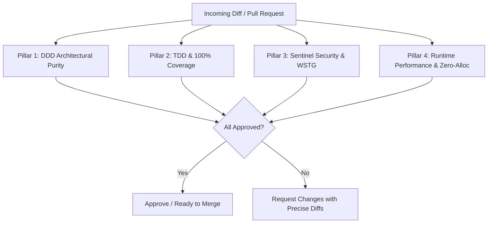

# Ferrox Code Reviewer Skill

This skill guides the agent in reviewing code changes against the four governing pillars of Ferrox engineering excellence.

---

## The 4-Pillar Code Review Checklist

---

### Pillar 1: DDD Architectural Purity
- [ ] Is the `domain/` layer completely free of framework, ORM, HTTP, or external I/O imports?
- [ ] Are Value Objects immutable and self-validating?
- [ ] Does the Aggregate Root protect its invariants and encapsulate state mutation?
- [ ] Are state changes triggered by Commands and signaled by Domain Events?

### Pillar 2: TDD & 100% Coverage
- [ ] Were unit tests written first, and are they pure without external I/O dependencies?
- [ ] Does `check_coverage.py` confirm **100.0% line and branch coverage**?
- [ ] Are edge cases (null, empty, boundary numbers, unicode) thoroughly tested?

### Pillar 3: Sentinel Security & OWASP WSTG
- [ ] Are input parameters recursively canonicalized and protected against high Shannon entropy ($H > 4.8$)?
- [ ] Is PASETO v4 token verification adhering to strict 10-second clock skew and AAD footer authentication?
- [ ] Are scarce resources guarded by atomic distributed locking (Redlock / row locks) against race conditions?
- [ ] Are public endpoints metered by sliding-window rate limiters?

### Pillar 4: Polyglot Performance & Idioms
- [ ] **Rust**: Are hot paths zero-alloc / zero-copy? Are there zero `unwrap()` or `expect()` calls in production code?
- [ ] **Rust Wasm**: Does the UI render within the 60 FPS (16.6ms) budget using fine-grained signals?
- [ ] **TypeScript / NestJS**: Is CQRS strictly adhered to with separated Command and Query buses?
- [ ] **Python**: Is `asyncio` non-blocking with frozen Pydantic v2 schemas?
- [ ] **Java**: Are virtual threads used without thread pinning or blocking synchronized blocks?
- [ ] **PHP**: Are distributed Sagas configured with forward steps and compensating actions?
