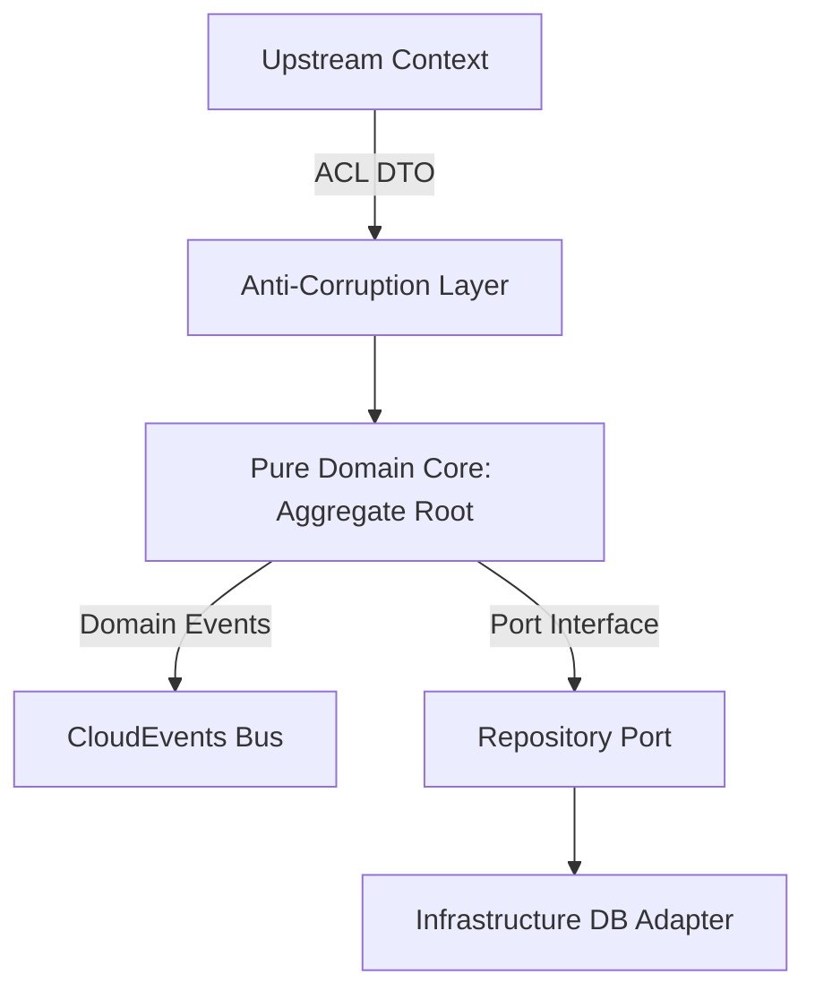

# Domain-Driven Design (DDD) Plan: [Feature Name]

## 1. Executive Summary & Bounded Context
- **Target Runtime(s)**: [Rust / TypeScript / Python / Java / PHP]
- **Target Repository**: [e.g. ferrox / nestjs-yalc / ferrox-py / ferrox-java / ferrox-php]
- **Context Description**: [Concise description of the bounded context]



---

## 2. Ubiquitous Language Dictionary

| Term | Category (Entity / VO / Event / Command) | Strict Definition & Business Meaning |
| :--- | :--- | :--- |
| `[TermName]` | Value Object | [Immutable representation of ...] |
| `[AggregateName]` | Aggregate Root | [Consistency boundary maintaining ...] |
| `[DomainEventName]`| Domain Event | [Published when ...] |

---

## 3. Aggregate Root Specification: `[AggregateName]`

### Invariants (Pre & Post Conditions)
1. **Invariant 1**: [Must always be true, e.g. Stock quantity cannot drop below zero]
2. **Invariant 2**: [e.g. Order cannot be canceled once shipped]

### Value Objects
- `[ValueObjectName]`: Immutable attributes, validation rules (e.g. `amount > 0`).

### Domain Methods
```text
+ executeOperation(param1: ValueObject, timestamp: Instant): Result<DomainEvent, DomainError>
+ cancelOperation(reason: RejectionReason): Result<DomainEvent, DomainError>
```

---

## 4. CQRS Architecture

### Commands (Write Model)
- **`[CommandName]`**:
  * Attributes: `[attr1, attr2, ...]`
  * Handler: `[CommandHandlerName]`
  * Emits: `[DomainEventName]`

### Queries (Read Model)
- **`[QueryName]`**:
  * Projection Target: `[ReadModelDto]`
  * Handler: `[QueryHandlerName]`

---

## 5. Polyglot Implementation Mapping

```[target-language]
// Concrete language skeleton showing types, traits, or classes
```

---

## 6. Next Steps Checklist
- [ ] User approval of `DDD_PLAN.md`
- [ ] Initialize TDD Session Matrix (`skills/ferrox-tdd-orchestrator`)
- [ ] Write first failing unit test (Red Phase)
