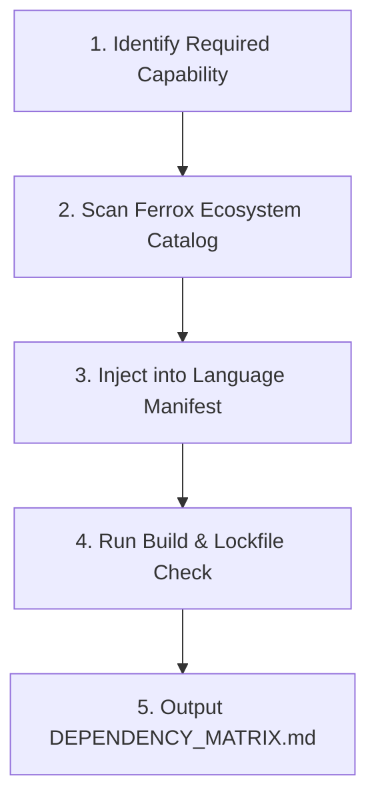

# Ferrox Dependency Resolver Skill

This skill guides the agent in enforcing the **Ferrox-First Dependency Policy**, identifying existing native packages, and injecting them into project build manifests.

---

## The Dependency Resolution Flow



---

## 1. Automated Manifest Injection

### Rust (`Cargo.toml`)
```toml
[dependencies]
# Native Ferrox ecosystem dependencies
ferrox-core = { version = "1.0", features = ["cqrs", "security", "saga"] }
ferrox-front-ui = { version = "0.2" }
```

### TypeScript / NestJS (`package.json`)
```json
{
  "dependencies": {
    "@nestjs-yalc/crud-gen": "^1.1.0",
    "@nestjs-yalc/data": "^1.1.0",
    "@nestjs-yalc/event-manager": "^1.1.0"
  }
}
```

### Python (`pyproject.toml`)
```toml
[project]
dependencies = [
    "ferrox-py>=1.0.0",
    "ferrox-py-auth>=1.0.0",
    "ferrox-py-commerce>=1.0.0",
]
```

### PHP (`composer.json`)
```json
{
  "require": {
    "ferrox/core": "^1.0",
    "ferrox/cqrs": "^1.0",
    "ferrox/events": "^1.0"
  }
}
```

---

## 2. Running the Dependency Resolver Script

```bash
python skills/ferrox-dep-resolver/scripts/resolve_ferrox_deps.py --check
```
The script inspects all manifests in the repository, validates that Ferrox native libraries are preferred, and flags any unapproved third-party packages.
