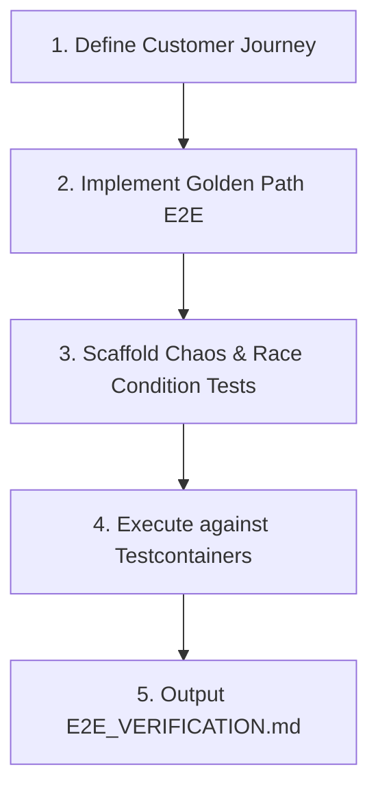

# Ferrox E2E Scaffolder Skill

This skill guides the agent in constructing end-to-end integration tests that validate complete polyglot workflows across Ferrox runtimes, covering both happy golden paths and harsh edge-case/chaos conditions.

## The 4-Step E2E Verification Protocol

---

## Step 1: Customer Journey Mapping
1. Trace the complete transaction across services:
   * Client / Wasm UI (`ferrox-front`) ->
   * API Gateway / Rust Core (`ferrox`) ->
   * Orchestrator / CQRS (`nestjs-yalc` / `ferrox-py` / `ferrox-java`) ->
   * Saga Coordinator / Persistence (`ferrox-php` / PostgreSQL / Redis).
2. Document expected HTTP status codes, event emissions, and database mutations.

---

## Step 2: Happy Path Test Implementation
- Write executable test in the target E2E directory (`tests/e2e/`).
- Verify:
  * Proper authentication headers (PASETO v4 token).
  * Payload schema validation (OpenAPI / Protobuf).
  * Domain event publication and consumption.
  * Correct database records created with idempotency.

---

## Step 3: Edge-Case & Chaos Suite
Implement tests for all mandatory chaos scenarios (from `rules/ferrox-e2e-contract-testing.md`):
1. **Concurrency Double-Spend**: Fire 20 concurrent worker threads competing for limited inventory. Verify zero overselling.
2. **Distributed Saga Compensation**: Inject failure into step 3 of a transaction. Verify all previous steps are rolled back via compensating transactions.
3. **Circuit Breaker Fault Injection**: Inject 5 downstream timeouts. Verify circuit breaker trips from `CLOSED` to `OPEN` and fails fast.
4. **Singleflight Stampede**: Fire 50 concurrent requests for an evicted cache key. Verify only 1 upstream query executes.
5. **Clock Skew & Token Boundary**: Test tokens at boundary limits ($t=0$, $t+1s$, $t+11s$).

---

## Step 4: Verification Artifact
Compile the execution logs, latencies, and pass/fail metrics into `E2E_VERIFICATION.md` following `skills/ferrox-e2e-scaffolder/templates/E2E_SCENARIO_SPEC.md`.
