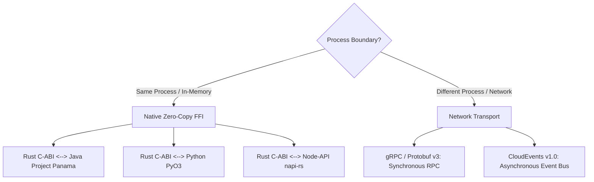

# Ferrox Polyglot Connector Skill

This skill guides the agent in establishing seamless, ultra-high-throughput bridges and contracts between Ferrox services across disparate programming languages.

---

## 1. Choosing the Connector Architecture



---

## 2. In-Process Native FFI Implementation Guide

### A. Java 21 Project Panama <--> Rust Core
1. **Rust Export**:
   ```rust
   #[no_mangle]
   pub extern "C" fn ferrox_calculate_hash(
       input_ptr: *const u8,
       input_len: usize,
       output_buf: *mut u8,
   ) -> i32 { ... }
   ```
2. **Java Panama Binding**:
   - Use `Linker.nativeLinker()` and `SymbolLookup`.
   - Allocate off-heap buffers using `Arena.ofConfined()` or `Arena.ofShared()`.
   - Slice zero-copy memory via `MemorySegment.ofAddress(...)`.

### B. Python PyO3 <--> Rust Core
1. Define PyO3 module with `#[pymodule]`.
2. Release Python GIL during intensive computations (`py.allow_threads(...)`).
3. Return native Python types or zero-copy `PyBytes`.

### C. Node-API (napi-rs) <--> Rust Core
1. Use `napi-rs` macro `#[napi]`.
2. For high-throughput buffer transfer, use `napi::bindgen_prelude::BufferSlice`.

---

## 3. Remote gRPC & Protobuf Contract Workflow
1. Write schema in `templates/CONNECTOR_CONTRACT.proto`.
2. Run automated stub generation:
   - Rust: `tonic-build` / `prost`
   - TypeScript: `ts-proto` / `@grpc/proto-loader`
   - Python: `grpc_tools.protoc`
   - Java: `protobuf-maven-plugin`
3. Execute Contract Verification Test asserting request/response serialization across runtimes.

---

## 4. Asynchronous CloudEvents Bus
- Ensure events emitted across runtimes conform strictly to CloudEvents v1.0 JSON or Protobuf binary format.
- Envelope must include `id`, `source`, `type`, `time`, `datacontenttype`, and `data`.
