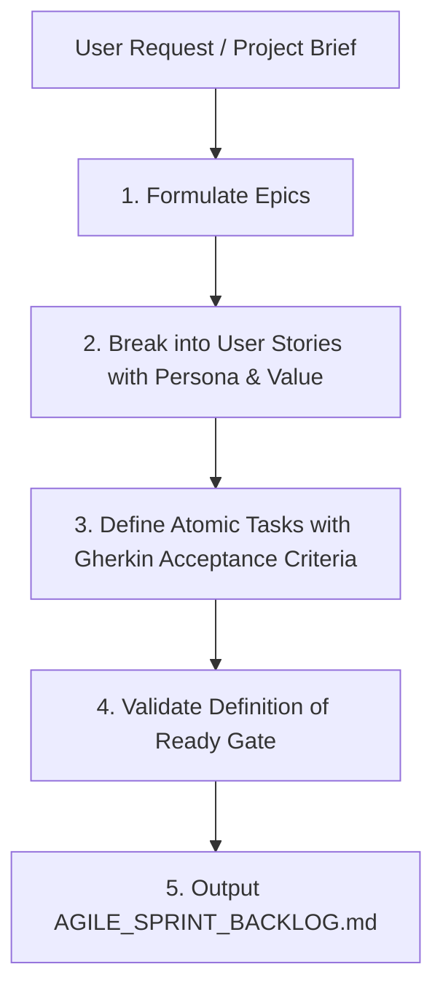

# Ferrox Scrum Master Skill

This skill guides the agent in breaking down high-level project briefs into actionable, structured Agile Sprint Backlogs with rigorous quality gates.

---

## The Scrum Breakdown Workflow



---

## Step 1: Epic & Story Formulation
- Identify key system capabilities and organize them into Epics.
- Format User Stories: `As a [persona], I want [capability] so that [business value]`.

---

## Step 2: Atomic Task Definition & Sizing
- Sizing rule: An atomic task must represent a single Git branch and a single Pull Request.
- Include explicit Gherkin Acceptance Criteria:
  ```gherkin
  Scenario: Order reservation with sufficient stock
    Given a customer with ID "cust_1" and product "prod_99" with stock 10
    When the customer submits an order for quantity 2
    Then 2 stock units are reserved atomically
    And the OrderAggregate state transitions to RESERVED
    And a StockReserved domain event is emitted
  ```

---

## Step 3: DoR & DoD Verification
- Verify that every task entering the sprint satisfies the **Definition of Ready** (from `rules/ferrox-agile-scrum-lifecycle.md`).
- Attach the **Definition of Done** checklist to each task (TDD first, 100% coverage, mutation tests, OWASP WSTG audit, ferrox-codex documentation).

---

## Step 4: Sprint Backlog Generation
Generate `AGILE_SPRINT_BACKLOG.md` using `templates/AGILE_SPRINT_BACKLOG_TEMPLATE.md` and present it to the user for sprint kickoff.
