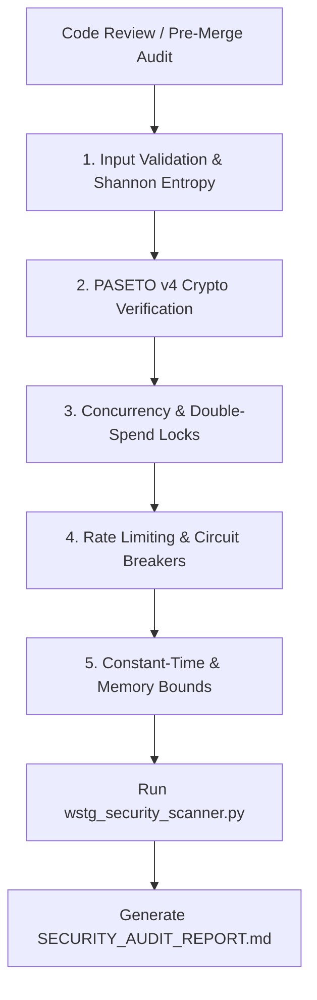

# Ferrox Security Auditor (Sentinel) Skill

This skill guides the agent in conducting thorough penetration testing and automated security hardening audits inspired by enterprise OWASP Web Security Testing Guide (WSTG) standards.

---

## The 5-Vector Security Audit Protocol



---

## Step 1: Input Validation & Obfuscation Fuzzing (WSTG-INPV-01 / WSTG-INPV-05)
- Inspect ingress parameters and body payloads for high Shannon entropy ($H > 4.8$).
- Verify that multi-layer URL/Hex encoded payloads (`%2527%2520UNION`) are recursively unquoted and canonicalized before passing to domain services.
- Verify path traversal checks reject `..`, `..%2f`, and null bytes.

---

## Step 2: PASETO v4 Cryptographic Hardening (WSTG-CRYP-01 / WSTG-ATHN-04)
- **Key Entropy**: Verify that symmetric keys (256-bit) are validated against low entropy (e.g. rejecting `\x00` * 32 or repeated bytes) at service boot.
- **AAD Footer Binding**: Ensure PASETO tokens authenticate the footer via Additional Authenticated Data in XChaCha20-Poly1305. If a client attempts to append or modify claims in the footer without valid authentication tag, rejection must occur.
- **Clock Skew Leeway**: Check token verification logic: `exp` and `nbf` must enforce a maximum clock skew leeway of **10 seconds**.

---

## Step 3: Concurrency & Business Logic Auditing (WSTG-BUSL-01 / WSTG-BUSL-02)
- Inspect state mutations involving scarce resources (stock, account balances, reservations).
- Ensure atomic locking mechanisms are in place (Redis Redlock or PostgreSQL `SELECT ... FOR UPDATE`).
- Verify high-frequency queries implement a `SingleflightController` to prevent cache stampedes / thundering herds.

---

## Step 4: Rate Limiting & Denial-of-Service Isolation (WSTG-INPV-08 / WSTG-CLNT-05)
- Verify sliding-window or token-bucket rate limiters return HTTP `429 Too Many Requests`.
- Verify external microservice calls are protected by a Circuit Breaker that fails fast when unhealthy (`OPEN` state).

---

## Step 5: Automated Scanner Execution & Reporting
Run the bundled Ferrox security scanner:
```bash
python skills/ferrox-security-auditor/scripts/wstg_security_scanner.py --json
```

Compile results into `SECURITY_AUDIT_REPORT.md` following `skills/ferrox-security-auditor/templates/SECURITY_AUDIT_REPORT.md`.
All findings marked `FAIL` must be remediated before production deployment or pull request merge.
