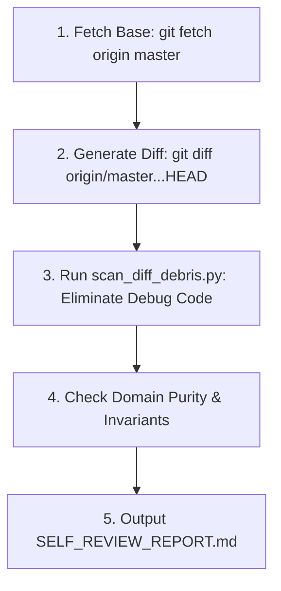

# Ferrox Self-Reviewer Skill

This skill guides the agent in conducting a rigorous self-audit on its own proposed changes before submitting a Pull Request.

---

## The 4-Step Self-Review Workflow



---

## 1. Inspecting the Diff

Run the automated diff debris scanner:
```bash
python skills/ferrox-self-reviewer/scripts/scan_diff_debris.py
```
If any added line contains `dbg!`, `println!`, `todo!`, `console.log`, `print()`, or `var_dump()`, the scanner fails with line numbers and file paths.

---

## 2. Architectural Audit Checklist

1. **Domain Purity**: Ensure that no file in `src/domain/` or `crates/*/src/domain/` imports database ORMs, HTTP controllers, or serialization frameworks.
2. **Value Object Immutability**: Verify that all Value Objects are immutable and self-validating.
3. **Zero-Alloc Performance**: In Rust hot paths, ensure buffers are sliced zero-copy (`bytes::Bytes`, `&[u8]`).
4. **Clean Working Tree**: Ensure untracked temporary files are removed.

---

## 3. Self-Review Report Generation

Compile the findings into `SELF_REVIEW_REPORT.md` using `templates/SELF_REVIEW_REPORT_TEMPLATE.md` and attach the summary to the Pull Request description.
