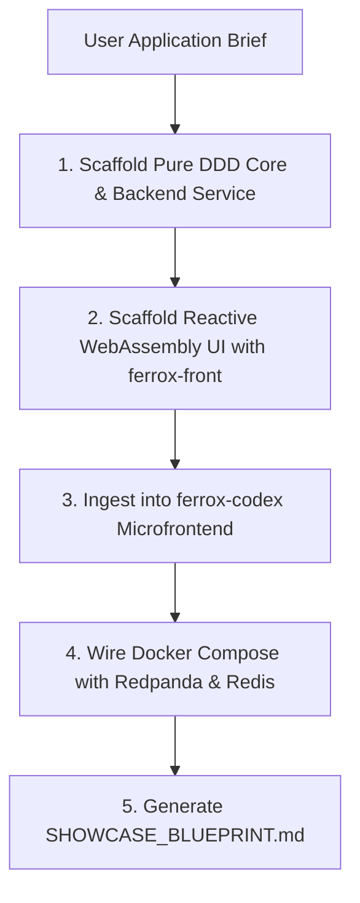

# Ferrox Showcase Generator Skill

This skill guides the agent in scaffolding a complete, working showcase application directly from a user brief, coupling backend domain logic, a reactive WebAssembly UI, and documentation on `ferrox-codex`.

---

## The Showcase Generation Workflow



---

## 1. Wasm UI Scaffolding (`ferrox-front`)
- Reactive signal state management:
  ```rust
  let (status, set_status) = create_signal("Idle".to_string());
  ```
- Direct DOM binding with vector SVG metrics visualization.

---

## 2. Interactive Documentation Integration (`ferrox-codex`)
- Generates markdown and architecture diagrams in `docs/`:
  * Sequence diagrams for Saga transactions.
  * Live WebAssembly sandboxes showcasing component performance.
  * API reference contracts (Protobuf and OpenAPI).
- Ingests the new module into `ferrox-codex.toml`.

---

## 3. Blueprint Generation
Compile the full architectural manifest into `SHOWCASE_BLUEPRINT.md` using `templates/SHOWCASE_BLUEPRINT.md`.
