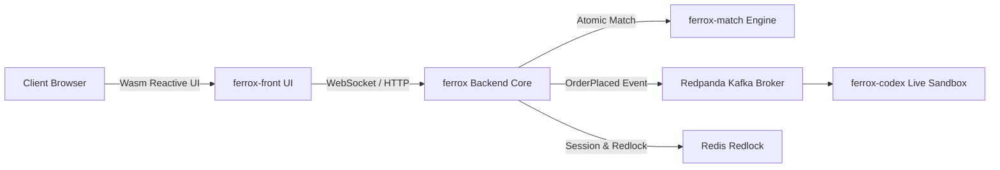

# Showcase Blueprint: [Application Name]

- **Showcase Name**: `[e.g. ferrox-fintech-exchange-showcase]`
- **Domain**: `[e.g. High-Frequency Matching Engine & Reactive Wasm Orderbook]`
- **Technologies Used**:
  * Backend Core: `ferrox`, `ferrox-core`, `ferrox-match`
  * Frontend UI: `ferrox-front`, `ferrox-front-ui`, `ferrox-front-charts`
  * Documentation Engine: `ferrox-codex`
  * Event Streaming & Caching: Redpanda (Kafka), Redis (Redlock)

---

## 1. System Topology



---

## 2. Directory Layout
```text
showcase/
├── crates/
│   ├── app-core/           # Backend DDD Aggregate & CQRS handlers
│   └── app-ui/             # ferrox-front reactive Wasm UI
├── docs/                   # ferrox-codex interactive documentation
│   ├── index.md
│   ├── architecture.md
│   └── sandbox.md
├── docker-compose.yml       # Local showcase orchestration
├── Dockerfile              # Distroless production container
└── ferrox-codex.toml       # Codex microfrontend manifest
```

---

## 3. Verification & Live Preview
- **Run Backend**: `cargo run --bin app-core`
- **Run Wasm UI**: `cd crates/app-ui && wasm-pack build --target web`
- **Preview on Ferrox-Codex**: `ferrox-codex serve --port 3000`
