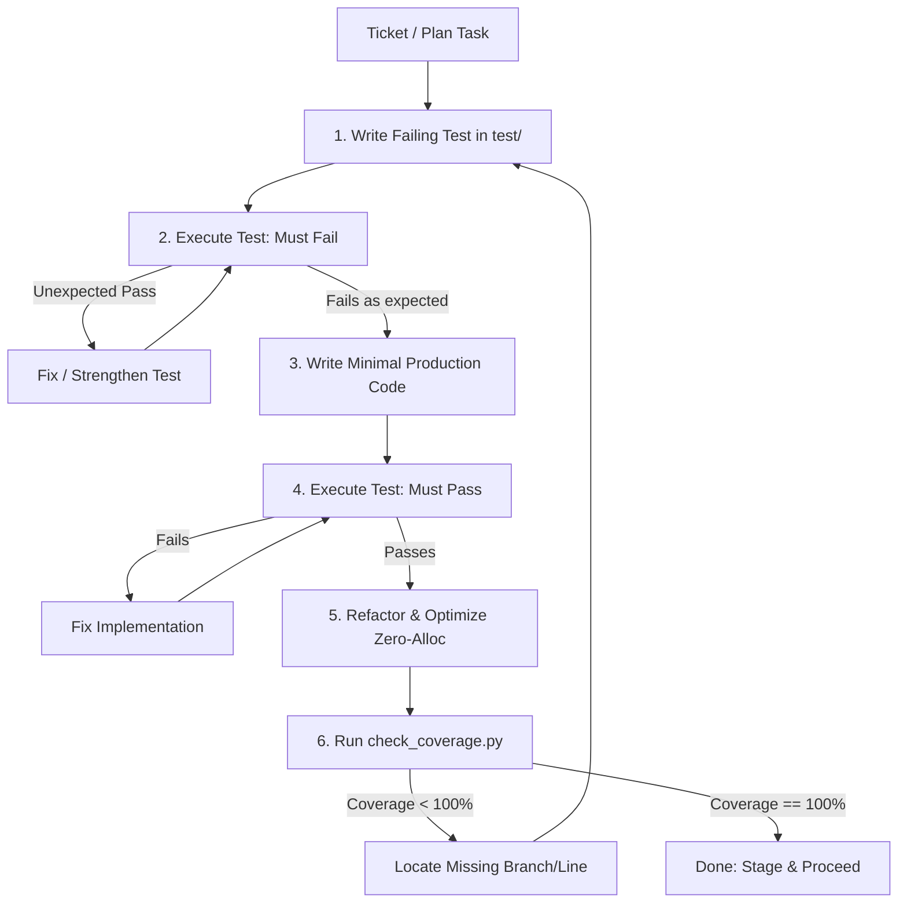

# Ferrox TDD Orchestrator Skill

This skill guides the agent through an uncompromising Test-Driven Development workflow, ensuring 100% coverage across lines, branches, and statements in all Ferrox polyglot repositories.

## Workflow: The Uncompromising TDD Loop



---

## Step-by-Step Execution Guide

### 1. Identify Test Target & Initialize Matrix
- Open or create `TDD_SESSION_MATRIX.md` (from `templates/TDD_SESSION_MATRIX.md`).
- List each invariant, business rule, and boundary condition as an individual test case.

### 2. Phase RED: Write the Test
- Location:
  * Rust: `tests/` or internal module `#[cfg(test)] mod tests;`
  * TypeScript: `test/unit/**/*.spec.ts`
  * Python: `tests/unit/test_*.py`
  * Java: `src/test/java/**/Test*.java`
  * PHP: `tests/Unit/*Test.php`
- Write the assertion testing the desired behavior.
- Run the test suite:
  * Rust: `cargo test --test <name>`
  * TypeScript: `npm test -- <name>`
  * Python: `pytest tests/unit/<name>.py`
  * Java: `mvn test -Dtest=<name>`
  * PHP: `vendor/bin/phpunit tests/Unit/<name>Test.php`
- **VERIFY**: The test MUST fail. Observe the failure message to ensure it fails because the feature is missing, not due to syntax or test harness errors.

### 3. Phase GREEN: Implement Minimal Code
- Write only enough code to turn the test green.
- Do not write speculative code or unexercised helper methods.
- Re-run the test: verify it passes.

### 4. Phase REFACTOR: Clean & Zero-Alloc
- Remove duplication.
- Improve naming.
- Ensure zero-alloc / zero-copy performance where applicable.
- Re-run tests: verify all tests remain green.

### 5. Phase 100% COVERAGE VERIFICATION
- Run the language coverage generator:
  * Rust: `cargo llvm-cov --lcov --output-path lcov.info`
  * TypeScript: `npm test -- --coverage`
  * Python: `pytest --cov=. --cov-report=xml --cov-report=term-missing`
  * Java: `mvn verify` (generates `target/site/jacoco/jacoco.xml`)
  * PHP: `vendor/bin/phpunit --coverage-clover coverage.xml`
- Run the universal Ferrox coverage validator:
  ```bash
  python scripts/check_coverage.py --target 100 [path_to_coverage_file]
  ```
- If coverage is below 100%, the script prints the exact unvisited line numbers and branch conditions. Write tests for those exact lines. Repeat until 100% is reached.
